<!-- _class: title ai ai-wine -->

Canal 3 Expo 2026 Keynote

# Retrogamena era das IAs

## O que andei contribuindo

<!--
Restam: ~60:00 (75s)

- Abrir direto: agente mudou o custo de construir software, não aboliu engenharia.
- A pergunta fraca é “IA substitui programador?”; a pergunta útil é qual processo sobrevive quando errar ficou barato e entregar ficou rápido.
- Tese da hora inteira: agente bom multiplica quem sabe dirigir e acelera a bagunça de quem não sabe.
- Entender "IA" direito é separar ferramenta de milagre: fundamento, teste, contexto e cerca continuam mandando.
-->
---

<!-- _class: center ai ai-olive -->
# Fabio Akita

  
<strong style="display:block;font-size:1.3em;margin-bottom:6px;">Codeminer 42</strong>cofundador, hoje no conselho

  
<strong style="display:block;font-size:1.3em;margin-bottom:6px;">RubyConf Brasil</strong>fundador e organizador até 2016

  
<strong style="display:block;font-size:1.3em;margin-bottom:6px;">akitaonrails.com ✦</strong>20 anos em 5 de abril de 2026, 830+ artigos, agora em pt-BR e en

  
<strong style="display:block;font-size:1.3em;margin-bottom:6px;"><svg width="22" height="22" viewBox="0 0 24 24" fill="#c4302b" style="vertical-align:-4px;margin-right:6px;"><path d="M23.498 6.186a3.016 3.016 0 0 0-2.122-2.136C19.505 3.545 12 3.545 12 3.545s-7.505 0-9.377.505A3.017 3.017 0 0 0 .502 6.186C0 8.07 0 12 0 12s0 3.93.502 5.814a3.016 3.016 0 0 0 2.122 2.136c1.871.505 9.376.505 9.376.505s7.505 0 9.377-.505a3.015 3.015 0 0 0 2.122-2.136C24 15.93 24 12 24 12s0-3.93-.502-5.814zM9.546 15.568V8.432L15.818 12l-6.272 3.568z"/></svg>@akitando</strong>575 mil inscritos no YouTube

  
<strong style="display:block;font-size:1.3em;margin-bottom:6px;"><svg width="20" height="20" viewBox="0 0 24 24" fill="currentColor" style="vertical-align:-3px;margin-right:6px;"><path d="M18.244 2.25h3.308l-7.227 8.26 8.502 11.24H16.17l-5.214-6.817L4.99 21.75H1.68l7.73-8.835L1.254 2.25H8.08l4.713 6.231zm-1.161 17.52h1.833L7.084 4.126H5.117z"/></svg>@akitaonrails</strong>98,8 mil seguidores no X

  
<strong style="display:block;font-size:1.3em;margin-bottom:6px;">Flow + Inteligência Ltda</strong>alcance além da bolha tech

<!--
Restam: ~58:45 (60s)

- Cards já mostram os números — aproveitar pra mencionar contexto
- RubyConf Brasil: fundei e organizei até 2016
- @akitando: entrevistas do Flow e Inteligência Ltda, alcance fora da bolha tech
- akitaonrails.com: 20 anos no dia 5 de abril de 2026, mesma data do artigo do benchmark — coincidência boa de puxar
- Fecha: "não é currículo, é pra explicar por que eu já vi essa fita antes e não compro hype fácil"
-->
---

<!-- _class: center ai ai-wine -->

CEOs Viraram Personagens

Fontes: Sam Altman/Village Global CC BY 2.0 • Dario Amodei/TechCrunch-Kimberly White CC BY 2.0 • Jensen Huang/Anders Eidesvik CC BY 4.0 • fundo/No 10 Downing Street

# Heróis ou Vilões

  

    
    
Sam Altman

    
OpenAI • hype, escala e Elon processando

  

  

    
    
Dario Amodei

    
Anthropic • shutdown, Fable 5 e Mythos 5

  

  

    
    
Jensen Huang

    
Nvidia • DLSS 5, China e escândalo pessoal

  

Mocinho e vilão é narrativa. O motor real é margem, compute e distribuição.

<!--
Restam: ~57:45 (45s)

- Tentação comum: transformar tudo em novela de CEO.
- Sam: hype, escala, e Elon processando. Dario: Fable 5, Mythos 5 e shutdown do governo.
- Jensen: gamer odiou o DLSS 5 e ele disse que os críticos estão "completamente errados"; briga pública contra o bloqueio de chips pra China.
- Jensen, escândalo pessoal (nov/2026): NYT e SF Standard reportam casos extraconjugais e investigação interna na Nvidia. Espionagem/"honeypot" chinês é boato de fonte anônima: NÃO afirmar como fato. Nenhuma decisão oficial do board até 19/nov.
- Mas o motor real é margem, compute, assinatura subsidiada, API cara, IPO e distribuição.
- Retratos: Sam by Village Global; Dario at TechCrunch Disrupt 2023 by TechCrunch/Kimberly White; ambos CC BY 2.0. Jensen em Stanford 2026 por Anders Eidesvik, CC BY 4.0.
- Ponte: pra entender incentivo, começa pelo básico — o que essa tecnologia é de verdade.
-->
---

<!-- _class: center ai ai-olive -->

Fonte: https://commons.wikimedia.org/wiki/File:Khao_Sok_primary_tropical_rainforest,_southern_Thailand.jpg

# Papagaios Estocásticos

  

    
  

  

    
Em 2026 ainda bajulam e erram

    
<strong>Loot box</strong>
probabilístico, não compilador determinístico

    
<strong>Bajula você</strong>
muitas vezes responde o que você quer ouvir

    
<strong>Erra confiante</strong>
inventa detalhe e segue como se estivesse certo

  

Agente sem freio é desastre: execução, teste e revisão continuam obrigatórios.

<!--
Restam: ~57:00 (100s)

- "Papagaio estocástico": termo de 2021, Bender, Gebru, McMillan-Major e Mitchell ("On the Dangers of Stochastic Parrots").
- Repete padrões de token com fluência, sem entender o que diz. Bonito de ler, fraco de compromisso com a verdade.
- Por isso chamo de loot box: probabilístico, não compilador determinístico.
- Modelo de 2026 ainda bajula: premissa torta, ele tende a agradar. E erra com confiança.
- O freio continua sendo execução real, teste real e revisão real.
-->

---

<!-- _class: center ai ai-umber -->

LLM Coding Benchmark v4 • 28/out/2026

# Top 20 de outubro

<table class="bench">
<tr><th class="rk">#</th><th>Modelo</th><th class="sc">Nota</th><th class="ct">Custo</th></tr>
<tr class="new"><td class="rk">1</td><td class="md">Gemini 4 Argon</td><td class="sc">100</td><td class="ct">OAuth</td></tr>
<tr><td class="rk">1</td><td class="md">GPT-6 Astra</td><td class="sc">100</td><td class="ct">$30,55</td></tr>
<tr><td class="rk">1</td><td class="md">Claude Opus 5</td><td class="sc">100</td><td class="ct">~$71</td></tr>
<tr><td class="rk">1</td><td class="md">Claude Fable 5</td><td class="sc">100</td><td class="ct">~$50</td></tr>
<tr><td class="rk">1</td><td class="md">Claude Opus 5.5</td><td class="sc">100</td><td class="ct">$16,63</td></tr>
<tr><td class="rk">1</td><td class="md">GPT-5.6 Sol</td><td class="sc">100</td><td class="ct">$20,37</td></tr>
<tr><td class="rk">1</td><td class="md">GPT-5.6 Terra</td><td class="sc">100</td><td class="ct">$9,52</td></tr>
<tr><td class="rk">1</td><td class="md">GPT-5.5</td><td class="sc">100</td><td class="ct">$34,69</td></tr>
<tr><td class="rk">9</td><td class="md">Grok 4.6</td><td class="sc">98,5</td><td class="ct">$13,00</td></tr>
<tr class="new"><td class="rk">10</td><td class="md">GPT-6.1 Sol</td><td class="sc">97,0</td><td class="ct">~$8,12</td></tr>
</table>
<table class="bench">
<tr><th class="rk">#</th><th>Modelo</th><th class="sc">Nota</th><th class="ct">Custo</th></tr>
<tr class="new"><td class="rk">10</td><td class="md">Muse Wonder 1.0</td><td class="sc">97,0</td><td class="ct">plano</td></tr>
<tr class="new"><td class="rk">12</td><td class="md">GPT-6.1 Terra</td><td class="sc">96,8</td><td class="ct">~$1,69</td></tr>
<tr><td class="rk">13</td><td class="md">Claude Fable 5.1</td><td class="sc">95,5</td><td class="ct">~$51</td></tr>
<tr><td class="rk">13</td><td class="md">Sakana Fugu Ultra v2</td><td class="sc">95,5</td><td class="ct">$122,01</td></tr>
<tr><td class="rk">13</td><td class="md">GPT-6 Luna</td><td class="sc">95,5</td><td class="ct">~$0,84</td></tr>
<tr><td class="rk">16</td><td class="md">GPT-5.6 Luna</td><td class="sc">95,0</td><td class="ct">$10,04</td></tr>
<tr><td class="rk">17</td><td class="md">Nex N2.5 Pro</td><td class="sc">94,0*</td><td class="ct">grátis</td></tr>
<tr><td class="rk">17</td><td class="md">GLM 5.3</td><td class="sc">94,0</td><td class="ct">plano</td></tr>
<tr><td class="rk">19</td><td class="md">DeepSeek V4.1 Flash</td><td class="sc">92,5</td><td class="ct">$1,21</td></tr>
<tr class="new"><td class="rk">20</td><td class="md">Kimi K3.1 Pro</td><td class="sc">92,1</td><td class="ct">~$12,67</td></tr>
</table>

 rodada nova • nota 0–100 • custo de uma rodada (~ = estimado por tokens) • *Nex achou os problemas, mas não fez commit • akitaonrails.com

<!--
Restam: ~55:20 (40s)

- Fonte: post de 28/out/2026, "Ranking comercial atualizado" (só rota gerenciada: API, assinatura, OAuth, plano).
- 8 modelos com 100. Custo e tempo é que separam: Opus 5.5 = $16,63 em 64 min; GPT-5.6 Sol = 317 min.
- Destaque de custo: GPT-6.1 Terra 96,8 com ~$1,69 em 21 min. GPT-6 Luna 95,5 com ~$0,84.
- Gemini 4 Argon chegou no topo via Antigravity (OAuth, custo marginal zero).
- Muse Wonder 97, mas levou quase 15 dias corridos por causa de quota.
- Sonnet 5.5 ficou fora do top 20 (88) mas é o 5º no índice amplo (Engineering Breadth Index).
- Ponte: nota alta virou commodity; a briga agora é custo, velocidade e quota.
-->
---

<!-- _class: center ai ai-umber -->

  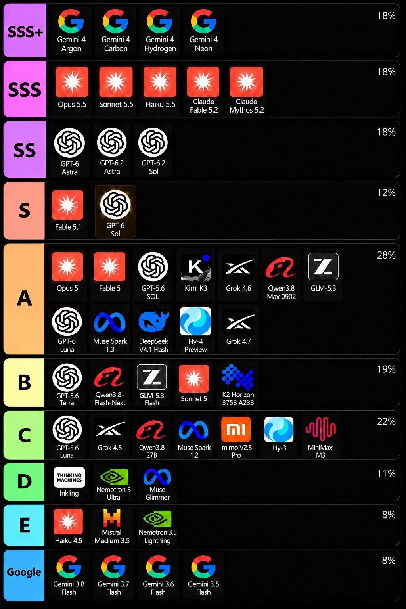

Tier list compartilhada no X, nov/2026

<!--
Restam: ~54:40 (25s)

- Sem título no slide: deixar a imagem respirar e falar por cima.
- Tier list que circulou no X essa semana. Autor não identificado: não atribuir a ninguém.
- Haiku 5.5 em SSS e Mythos 5.2 / Fable 5.2 nem passaram pelo meu benchmark ainda.
- Sonnet 5.5 em SSS faz sentido no índice amplo (5º no Engineering Breadth Index), mas não no projeto longo (88).
- Ponte: opinião em formato de ranking é barato. Medir dá trabalho. Por isso eu meço.
-->
---

<!-- _class: center ai ai-umber -->

LLM benchmark v5 • 20/nov/2026

# Quanto custa ser competente

barato e rápidomeio de tabelapesos-pesados

  
GPT-6 LunaUS$0,15

  
GPT-6.1 TerraUS$0,50

  
DeepSeek V4.1 FlashUS$0,56

  
Qwen 4 MaxUS$1,78

  
Gemini 4 HydrogenUS$1,89

  
GPT-6.2 SolUS$2,02

  
Claude Sonnet 5.5US$2,14

  
Kimi K3.1 ProUS$2,66

  
Gemini 4 NeonUS$3,10

  
Gemini 4 CarbonUS$3,29

  
DeepSeek V4 ProUS$3,39

  
Claude Opus 5.5US$5,73

  
GPT-6.2 AstraUS$5,78

  
GLM-5.3US$6,08

  
Claude Fable 5.2US$12,96

  
Grok 4.7US$14,19

Custo real de API com cache, uma rodada por modelo. Os 16 entregaram o mesmo app Rails testado, sem nenhum empurrão. • akitaonrails.com

<!--
Restam: ~54:15 (40s)

- Mesma tarefa pros 16: app Rails de chat com RubyLLM, 14 objetivos (Tailwind, Hotwire, streaming, testes, RuboCop, Brakeman, Docker). Todos passaram de primeira, zero nudges.
- Diferença de ~95x no preço (US$0,15 a US$14,19) e ~12x no tempo.
- Cache é tudo: 94% a 99% do input foi leitura de cache, corta 69% a 94% da conta. Preço por milhão de tokens na tabela engana.
- Verbosidade manda: GPT-6.2 Astra e Claude Fable 5.2 têm o mesmo preço de tabela, o Astra saiu por menos da metade.
- Chinês não é automaticamente barato: GLM-5.3 saiu mais caro que o Opus 5.5 no preço oficial.
- Ressalvas: uma rodada só; Gemini 4 Carbon em preço promocional até 30/nov (dobra pra US$6,58); Opus inclui ~US$1,69 de dois nudges falsos de um bug do runner.
- Ponte: competente o suficiente já é barato. A pergunta deixa de ser "qual o melhor" e vira "quanto você paga por rodada".
-->

---
<!-- _class: center ai ai-umber -->

A curva da corrida de treino

# Não era exponencial

<svg viewBox="0 0 1040 520" role="img" aria-label="Curva S mostrando corrida de treino, inflexão em 2024 e retornos decrescentes" style="width:100%;max-height:430px;height:auto;display:block;">
  <defs>
    <marker id="arrow-s" markerWidth="10" markerHeight="10" refX="8" refY="5" orient="auto" markerUnits="strokeWidth">
      <path d="M0,0 L10,5 L0,10 z" fill="#3c2f2f" />
    </marker>
    <linearGradient id="curveGrad" x1="0" x2="1" y1="0" y2="0">
      <stop offset="0%" stop-color="#6b8e5a" />
      <stop offset="52%" stop-color="#c98a2e" />
      <stop offset="100%" stop-color="#b2463f" />
    </linearGradient>
    <filter id="softShadow" x="-10%" y="-10%" width="120%" height="120%">
      <feDropShadow dx="0" dy="10" stdDeviation="10" flood-color="#000" flood-opacity="0.18"/>
    </filter>
  </defs>

  <rect x="30" y="20" width="980" height="460" rx="26" fill="rgba(255,248,231,0.54)" stroke="rgba(60,47,47,0.16)" filter="url(#softShadow)" />

  <line x1="120" y1="410" x2="930" y2="410" stroke="#3c2f2f" stroke-width="3" marker-end="url(#arrow-s)" />
  <line x1="120" y1="410" x2="120" y2="72" stroke="#3c2f2f" stroke-width="3" marker-end="url(#arrow-s)" />
  <text x="928" y="448" text-anchor="end" font-size="26" fill="#3c2f2f" font-weight="700">investimento / compute</text>
  <text x="74" y="84" text-anchor="middle" font-size="26" fill="#3c2f2f" font-weight="700" transform="rotate(-90 74 84)">ganho marginal</text>

  <path d="M135 392 C230 390, 280 356, 332 310 C398 250, 430 154, 524 116 C612 80, 718 78, 902 76" fill="none" stroke="url(#curveGrad)" stroke-width="13" stroke-linecap="round" />

  <path d="M327 338 C392 286, 430 176, 535 116" fill="none" stroke="#c98a2e" stroke-width="3" stroke-dasharray="10 8" />
  <circle cx="327" cy="338" r="9" fill="#c98a2e" />
  <text x="300" y="314" text-anchor="end" font-size="26" font-weight="900" fill="#7a4a16">2022</text>
  <text x="430" y="326" text-anchor="middle" font-size="28" font-weight="900" fill="#7a4a16">parece exponencial</text>
  <text x="430" y="360" text-anchor="middle" font-size="22" fill="#7a4a16">quando você só olha o miolo</text>

  <line x1="662" y1="92" x2="662" y2="410" stroke="#b2463f" stroke-width="3" stroke-dasharray="8 8" />
  <circle cx="662" cy="87" r="11" fill="#b2463f" />
  <text x="682" y="132" font-size="30" font-weight="900" fill="#8a2f2a">2024+</text>
  <text x="682" y="164" font-size="23" fill="#8a2f2a">retorno decrescente brutal</text>

  <path d="M675 92 C740 78, 815 76, 904 76" fill="none" stroke="#b2463f" stroke-width="4" stroke-dasharray="5 10" />
  <text x="788" y="46" text-anchor="middle" font-size="24" font-weight="800" fill="#8a2f2a">mais 1 ordem de grandeza</text>
  <text x="788" y="70" text-anchor="middle" font-size="20" fill="#8a2f2a">custaria muito mais que tudo antes</text>

  <text x="230" y="430" text-anchor="middle" font-size="18" fill="#46633d" font-weight="800">décadas de pesquisa lenta</text>
  <text x="486" y="430" text-anchor="middle" font-size="19" fill="#7a4a16" font-weight="800">corrida de treino</text>
  <text x="740" y="430" text-anchor="middle" font-size="19" fill="#8a2f2a" font-weight="800">otimização + agentes</text>
</svg>

A parte rápida da curva enganou todo mundo.

<!--
Restam: ~53:35 (55s)

- Mostrar só a intuição: parecia exponencial porque a gente estava no miolo da curva S.
- Desde 2024, retorno marginal de treino ficou brutalmente pior.
- Mais uma ordem de grandeza exigiria capital/energia/compute desproporcional.
- Por isso a indústria muda foco: eficiência, produto e agentes.
-->
---

<!-- _class: center ai ai-olive -->

Linha Do Tempo

Fonte: https://commons.wikimedia.org/wiki/File:Smith_Matrix_mannequins.jpg

# A grande mudança em 2025: AGENTES

  
<strong>mar 2025</strong>Responses API, tools e Agents SDK viram produto

  
<strong>mai 2025</strong>Claude 4 pensa entre tool calls e Claude Code vira GA

  
<strong>ago 2025</strong>GPT-5 aguenta loop mais longo e erra menos no uso de ferramenta

  
<strong>nov 2025</strong>GPT-5.1 e Opus 4.5 refinam uso diário

Não foi um dia mágico. Foi o ano inteiro fechando modelo, thinking, tool support e operação.

<!--
Restam: ~52:40 (65s)

- Pra mim, 2025 foi o ano em que a pilha foi fechando.
- Em março, tool support virou plataforma de verdade.
- Em maio, a Anthropic já estava falando de thinking com tool use e colocando Claude Code em circulação séria.
- Em agosto e novembro, os modelos de fronteira ficaram mais estáveis nesse loop.
-->
---

<!-- _class: center ai ai-olive -->

Convergência

Fonte: https://commons.wikimedia.org/wiki/File:2025_New_Year_Fireworks_in_Tamsui,_New_Taipei_(54238509557).jpg

# Dezembro de 2025 foi a Virada

  
<strong>OpenAI — 13 nov</strong> GPT-5.1 sai pra desenvolvedores e o Codex CLI finalmente fica bom o bastante pra rodar tarefa longa de verdade no terminal

  
<strong>Anthropic — 24 nov</strong> Claude Opus 4.5 sai e o Claude Code amadurece com thinking entre tool calls, execução em background e fluxo de agente sério

Modelo novo + CLI de agente madura, os dois ao mesmo tempo. Em dezembro deu pra apostar tempo de verdade. Em janeiro de 2026 eu entrei nessa também — foi daí que saiu a maratona.

<!--
Restam: ~51:35 (75s)

- Datas marcantes: 13 nov (GPT-5.1 + Codex CLI), 24 nov (Opus 4.5 + Claude Code), 11 dias de distância
- A chave não foi só o modelo novo — foi a CLI de agente amadurecendo junto, nos DOIS lados na mesma janela
- Dezembro 2025: muita gente boa começou a testar pra valer no trabalho real
- Janeiro 2026: foi quando eu entrei na maratona — primeira vez que senti que valia apostar tempo
- Puxa a ponte pro próximo slide: "parei de opinar e fui testar com pele em jogo"
-->
---

<!-- _class: center ai ai-wine -->

60 projetos (experimentais) • 14.022 contribuições

<h1 style="font-size:1.9em;margin:6px 0 4px 0;">Fevereiro a novembro de 2026</h1>

## eu parei de falar e fui maratonar

  

"São todos perfeitos, modelos de excelência de código?" <strong>Absolutamente não.</strong> São experimentos: alguns viraram software de uso diário, outros são protótipos.

Fonte: https://commons.wikimedia.org/wiki/File:Mount_Everest_as_seen_from_Drukair2_PLW_edit.jpg

<!--
Restam: ~50:20 (42s)

- Então eu parei de opinar e fui testar com pele em jogo. Começou em fevereiro e não parou: continua até agora, novembro.
- Não com prompt de brinquedo, não com videozinho fake de SaaS em dez minutos. Projeto real.
- 14.022 contribuições no GitHub nos últimos 12 meses. Repara: de fevereiro pra cá quase não tem dia vazio.
- 60 projetos de 2026 que eu criei (lista do ghpending, sem forks de projetos dos outros como omarchy e flea).
- De FrankMD e ai-jail até a série rea-* de jogos de corrida antigos (Colin McRae, Sega Rally, Outrun, TeknoParrot).
- Nem todos são produção. O ponto foi rodar o ciclo de agente de verdade em escala.
-->
---

<!-- _class: center ai ai-umber -->
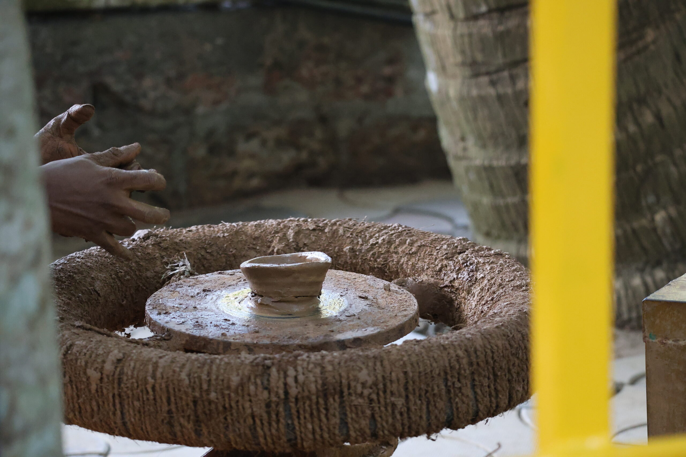

Painel de Projetos

Fonte: https://commons.wikimedia.org/wiki/File:Potter_shaping_clay_on_a_traditional_manual_potter’s_wheel_in_India_01.jpg

# Do zero pra software real

  
  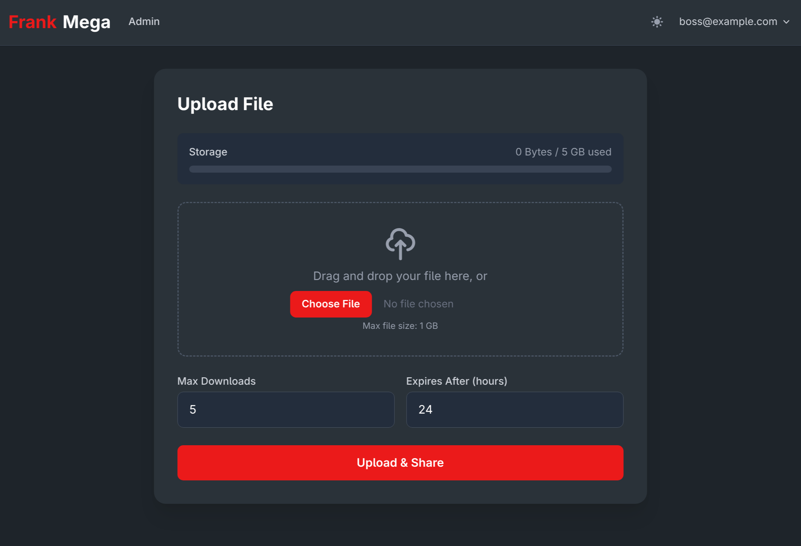
  
  
  
  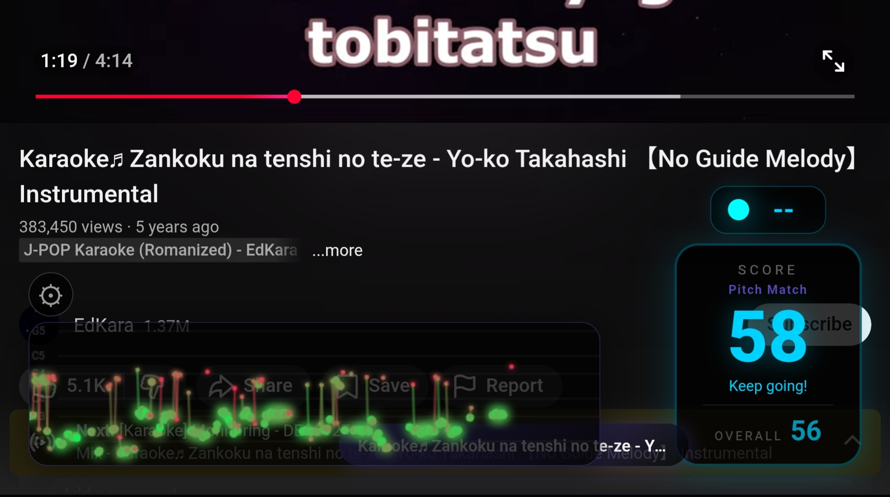
  
  

<!--
Restam: ~49:38 (35s)

- Este slide é só a parede de projetos.
- FrankMD, FrankMega, Frank Sherlock, Frank Yomik, Frank FBI, Frank Karaoke e outros.
- O objetivo não é explicar repositório por repositório.
- O objetivo é mostrar volume e variedade: desktop, Rails, Rust, Flutter, ferramentas, mídia, deploy, software em uso real.
-->
---

<!-- _class: center ai ai-umber -->

Recorte jan–nov/2026

Fonte: https://commons.wikimedia.org/wiki/File:African_Bull_elephant_walking_towards_camera_in_August_2013.jpg

# Números que pesam

  
<strong>~1,8 mi</strong>linhas úteis

  
<strong>~256 mil</strong>linhas de teste

  
<strong>13.614</strong>commits meus

  
<strong>~1.540 h</strong>horas ativas estimadas

60 projetos AI-assisted de 2026, contados em nov/2026. Tokei sem linhas em branco, só arquivo rastreado no git. Fora: JSON, dados gerados, resultados de benchmark, fixtures, assets, vendor e código de terceiros. Em repo com contribuidores, só a minha fatia. Blog só no recorte AI-era.

<!--
Restam: ~49:03 (95s)

- Ferramenta: `bin/c3-metrics` (tokei), lista de repos do ghpending.
- Fora da conta: forks de projeto alheio (omarchy, flea, clock-tui, docker-resolve) e repos anteriores a 2026.
- Repo com comunidade (ai-memory, ai-usagebar, FrankMD, ai-jail): conta só a % de linhas adicionadas por mim.
- frank_geary e frank_go começam com histórico upstream: conta só o que eu adicionei por cima.
- Maiores: ai-memory (~356 mil c/ teste), rea-colin-mcrae-recomp (~231 mil), nes-to-sms (~144 mil), worldreports (~129 mil).
- Horas: sessões por commit, 90 min de corte, +20 min por sessão, teto de 8 h.
- Em maio eram 30 projetos e ~432 mil linhas. Em seis meses, mais de 4x.
- Fecha: "agora dá pra discutir mecanismo, não fé"
-->
---

<!-- _class: center ai ai-umber -->

Recomendação prática

# As únicas ferramentas pra usar agora

  

    
<i></i><i></i><i></i><strong>Claude Code</strong>modelo fechado

    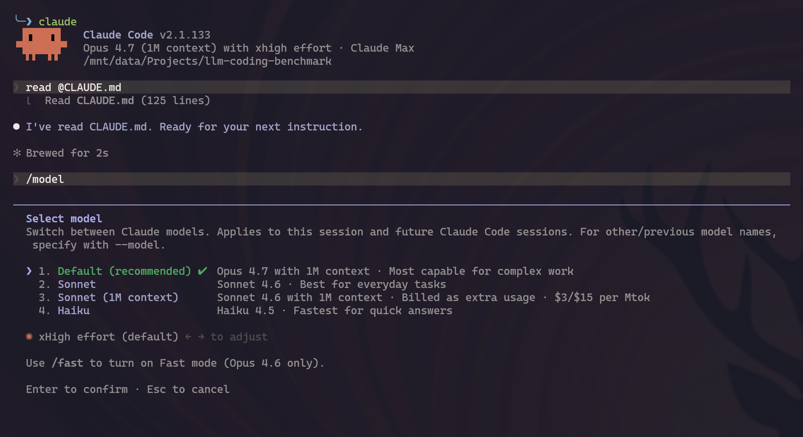
  

  

    
<i></i><i></i><i></i><strong>Codex</strong>modelo fechado

    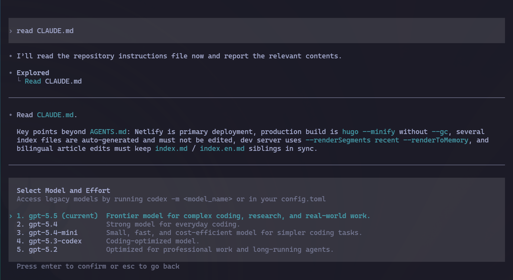
  

  

    
<i></i><i></i><i></i><strong>opencode</strong>qualquer modelo

    
  

  

    
<i></i><i></i><i></i><strong>Oh-My-Pi</strong>qualquer modelo

    
  

<!--
Restam: ~47:28 (20s)

- Em maio de 2026, estes quatro cobrem o caso sério de agente de terminal.
- Claude Code e Codex para fronteira fechada.
- opencode e Oh-My-Pi para modelo agnóstico, benchmark e OpenRouter.
-->
---

<!-- _class: center ai ai-umber -->
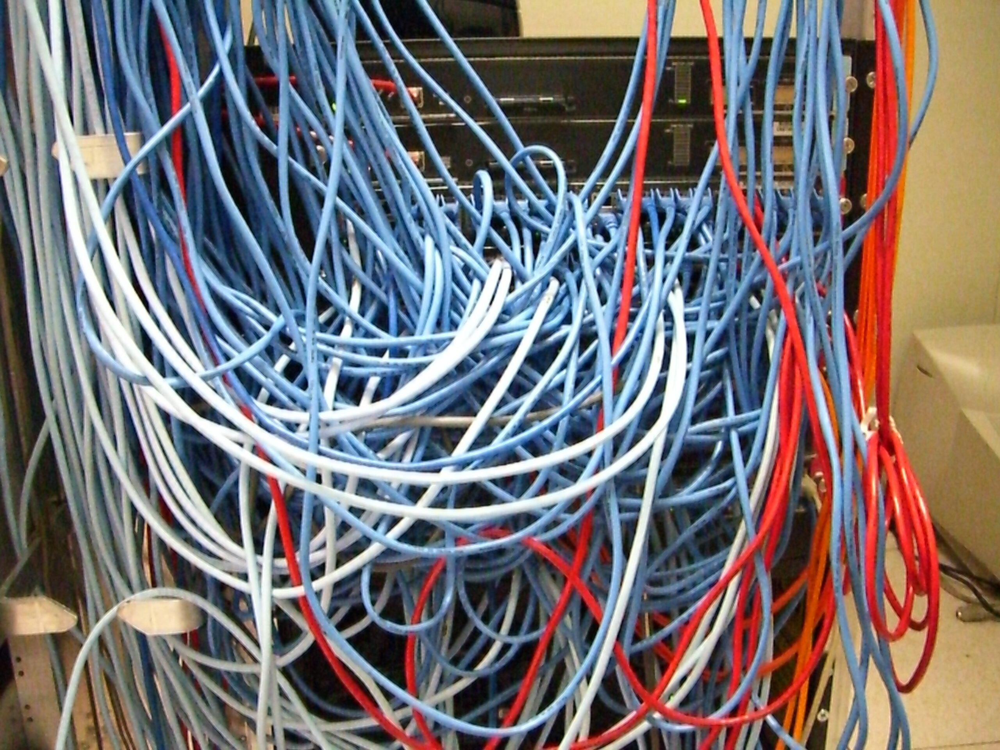

Toolkit open source

Fonte: https://commons.wikimedia.org/wiki/File:Server_Rack_with_Spaghetti-Like_Mass_of_Network_Cables.jpg

# Trocar de harness sem perder controle

  

    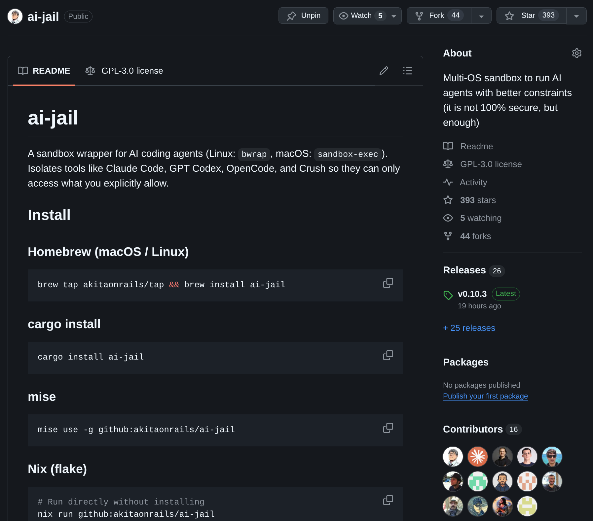
    <strong style="font-size:1.2em;">ai-jail</strong>
    
autonomia do agente com cerca no sistema de arquivos

  

  

    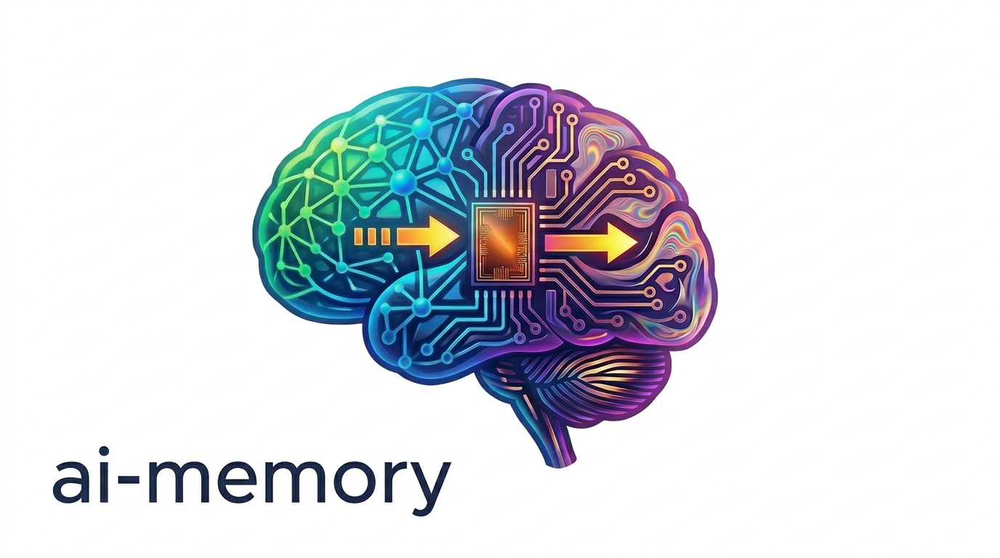
    <strong style="font-size:1.2em;">ai-memory</strong>
    
contexto que sobrevive ao Claude, Codex e opencode

  

  

    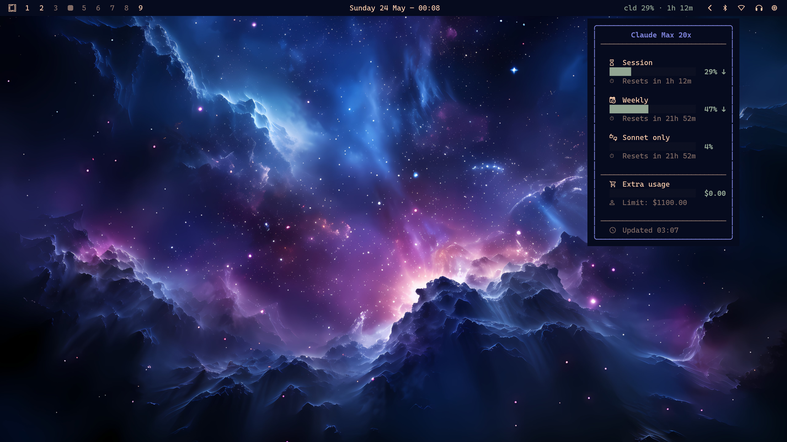
    <strong style="font-size:1.2em;">ai-usagebar</strong>
    
limite de plano visível antes de travar no meio da refatoração

  

<!--
Restam: ~47:08 (25s)

- Não é mais um orquestrador mágico.
- É kit de operação: cerca, memória e medidor de limite.
- Usagebar é apoio. Jail e memory são os conceitos importantes para trocar de harness sem virar bagunça.
-->
---

<!-- _class: center ai ai-wine -->

  

aijail.io

<!--
Restam: ~46:43 (40s)

- Sandbox de SO pro agente: Linux e macOS. Projeto read-write; host, home, cache e dotfiles fora ou controlados.
- Uso preferido: modo sem freio no harness (Claude/Codex sem confirmar cada passo), trava no SO.
- Política versionável: .ai-jail, --dry-run, --mask .env, --private-home, --lockdown.
- Não vender como segurança absoluta: sandbox de processo não é VM ("NOT A VM" no próprio site).
-->
---

<!-- _class: center ai ai-olive -->

  

aimemory.sh

<!--
Restam: ~46:03 (40s)

- Problema: harness compacta ou acaba, e o próximo agente esquece as últimas horas.
- Hooks capturam prompt, chamada de ferramenta, decisão e limite de sessão; vira wiki markdown, FTS5, handoff e busca via MCP.
- Troca de agente sem reexplicar: fecha Claude hoje, abre Codex amanhã no mesmo diretório.
- Open source (MIT), um binário, sem API key de modelo no básico. ~16 mil estrelas no GitHub.
- Documentação importante ainda vai para `docs/`; memória cobre o transitório que seria perdido.
-->
---

<!-- _class: center ai ai-umber -->

Fonte: https://commons.wikimedia.org/wiki/File:Basra_bodybuilding_competition_DVIDS288972.jpg

# Alcançamos "Developer 10x"?

  
<strong>5x a 10x</strong>de velocidade

  
<strong>Mais tração</strong>menos bloqueio, menos procrastinação

  
<strong>Mais alcance</strong>stack inteira, ferramentas, deploy, documentação

  
<strong>Mais confiança</strong>testes, integração contínua, refatoração, produção

<!--
Restam: ~45:23 (90s)

- Da minha experiência prática, o resumo honesto é 5x a 10x de velocidade.
- Não porque o modelo escreve código perfeito.
- Não escreve.
- O ganho vem porque ele atravessa aquele atrito chato que normalmente quebra foco: código repetitivo, busca, refatoração repetitiva, teste repetitivo, execução de comando, tentativa rápida.
-->
---

<!-- _class: center ai ai-olive -->

  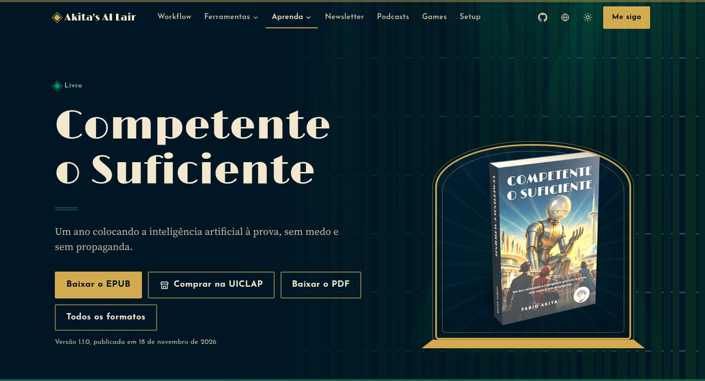

ailair.akitaonrails.com/pt-br/book

<!--
Restam: ~43:53 (40s)

- Livro: "Competente o Suficiente — um ano colocando a IA à prova, sem medo e sem propaganda".
- Artigos do ano no blog, reorganizados como uma história só, fatos rechecados e ilustrado.
- EPUB e PDF grátis, agora e em todas as versões. Impresso (UICLAP) e Kindle a preço de custo: sem lucro.
- Versão 1.1, publicada em 18/nov/2026. Aberto a correções: qualquer um abre issue no GitHub.
- Pra quem: o profissional com medo de ser substituído, o pai que leu que AGI chega em dois anos, o gerente recebendo "transformação com IA".
-->
---

<!-- _class: center tone-extra-dark rg rg-linux -->

  

github.com/akitaonrails/distrobox-gaming

<!--
Restam: ~43:13 (30s)

- Lado pessoal da maratona: games.
- distrobox-gaming: um container com todos os emuladores já configurados (RetroArch, DuckStation, PCSX2, RPCS3, shadPS4, xemu...).
- 481 estrelas, 49 forks, 683 commits. Tem até role de Ansible pro Colin McRae Rally (Recomp).
- Script pra quem não quer passar um fim de semana configurando emulador.
-->
---

<!-- _class: center tone-extra-dark rg rg-linux -->

  

A ponte: DOSBox, dgVoodoo2, DXVK e Xidi

<!--
Restam: ~42:43 (40s)

- Windows 11 só existe em 64 bits. Programa de 32 bits ainda roda (WoW64); o que morreu foi o subsistema de 16 bits e o DOS. Screamer só roda no DOSBox.
- Glide: API própria da 3dfx pras placas Voodoo. A 3dfx quebrou em 2000 e foi comprada pela Nvidia; não existe driver. O DOSBox emula a Voodoo.
- WinG (1994): gráfico rápido pro Windows 3.1, antes do DirectX. Nenhum dos meus jogos usa; serve pra mostrar a linhagem.
- Colin 1998: DirectDraw + Direct3D 5, menu em 8 bits de paleta e o dispositivo "Ramp" de software. O Windows moderno não tem nenhum dos dois: dgVoodoo2.
- Colin 3: SecuROM/SafeDisc dependem de driver bloqueado desde 2015. Colin 2005 só liberava partículas em Pentium 4 com Hyper-Threading. Colin 04 queria admin pra gravar no registro.
- Sega Rally Revo: Windows 10 e 11 não trazem os arquivos do DirectX 9 (D3DX); o launcher baixa da Microsoft.
-->

---

<!-- _class: center tone-extra-dark rg rg-linux -->

  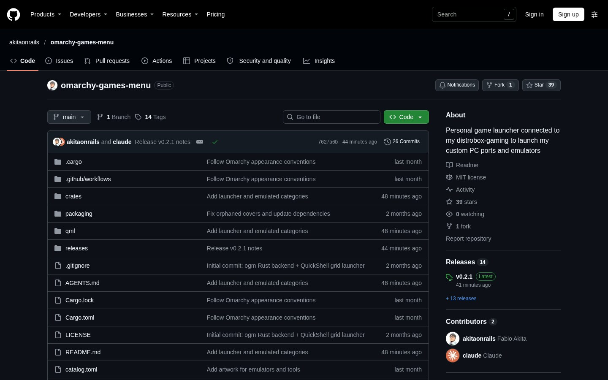

github.com/akitaonrails/omarchy-games-menu

<!--
Restam: ~42:03 (25s)

- omarchy-games-menu: launcher pessoal ligado no distrobox-gaming.
- Backend em Rust + grade em QuickShell, segue o tema do Omarchy.
- Abre emulador, port de PC e as minhas versões customizadas num lugar só.
- v0.2.1, 14 releases.
-->
---

<!-- _class: center tone-extra-dark rg rg-linux -->
<!-- pptx-video: omarchy-games-menu -->

  <video class="deck-video" src="../assets/games/omarchy-games-menu.mp4" poster="../assets/games/omarchy-games-menu.jpg" muted autoplay loop playsinline preload="auto" style="height:560px;border-radius:14px;box-shadow:0 18px 40px rgba(0,0,0,0.35);background:#000;"></video>

A coleção inteira num menu só, no Omarchy

<!--
Restam: ~41:38 (20s)

- Vídeo sem som: só deixar rodar.
- Capa por jogo, categoria por plataforma, de Donkey Kong a Sega Rally, até RPCS3, shadPS4 e xemu.
-->
---

<!-- _class: center tone-extra-dark rg rg-linux -->

  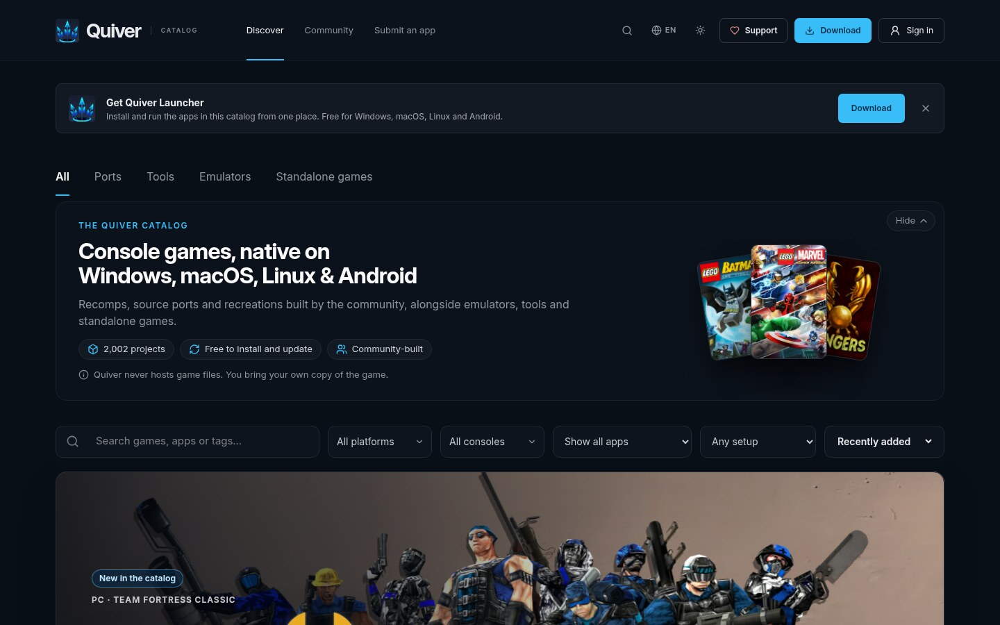

quiverlauncher.com

<!--
Restam: ~41:18 (30s)

- Quiver: catálogo e launcher de recomps, source ports, recriações, emuladores e ferramentas. Grátis pra Windows, macOS, Linux e Android.
- 2.002 projetos no catálogo hoje (20/nov/2026), feitos pela comunidade.
- Não hospeda arquivo de jogo: você traz a sua cópia. Mesma regra dos meus launchers.
- Detalhe bom pra esta palestra: tem filtro pra esconder apps feitos majoritariamente com IA, ou com qualquer uso de IA.
- Ponte: é nesse ecossistema de recomp que o Colin McRae entra.
-->

---

<!-- _class: center tone-extra-dark rg rg-rally -->
<!-- pptx-video: colin-duckstation -->

Desde o PlayStation

<h1 style="font-size:1.5em;margin:4px 0 14px 0;">Eu sempre amei Colin McRae</h1>

  <video class="deck-video" src="../assets/games/colin-duckstation.mp4" poster="../assets/games/colin-duckstation.jpg" data-volume="0.25" loop playsinline preload="auto" style="height:560px;border-radius:14px;box-shadow:0 18px 40px rgba(0,0,0,0.35);background:#000;"></video>

Colin McRae Rally 2.0 no PlayStation, via DuckStation (resolução original)

<!--
Restam: ~40:48 (30s)

- Confissão: eu sempre amei Colin McRae Rally, desde o PlayStation.
- Isso é o Colin 2.0 rodando no DuckStation, do jeito que era: 4:3, polígono tremendo, textura borrada.
- Volume do vídeo em 25%: deixar o motor aparecer um pouco.
- Ponte: e se desse pra jogar a versão de PC num PC moderno, do jeito certo?
-->
---

<!-- _class: center tone-extra-dark rg rg-rally -->

  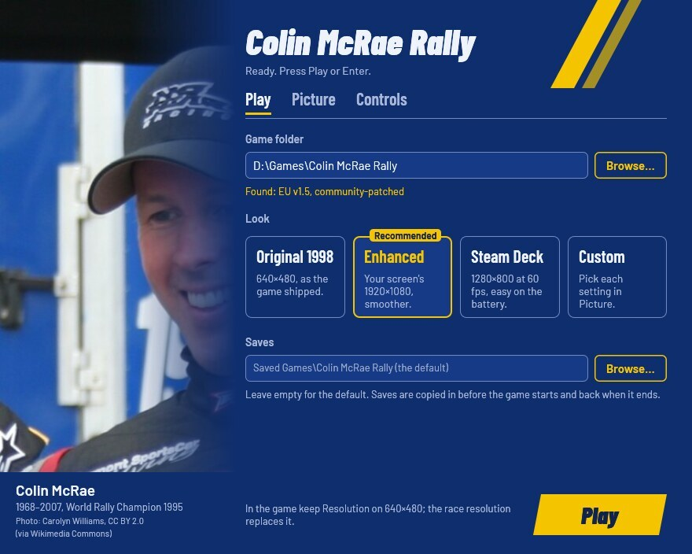

rea-colin-mcrae • launcher pro Colin McRae Rally (1998) de PC

<!--
Restam: ~40:18 (30s)

- rea-colin-mcrae: launcher pro Colin McRae Rally original de PC, adaptado pra PC moderno.
- Escolhe a pasta do jogo e o "look": Original 1998 (640x480), Enhanced (resolução da sua tela), Steam Deck ou Custom.
- Roda em Windows e Linux. Saves ficam separados.
- v0.10.5, 842 commits, 24 releases. Post no blog: "Consertei vários jogos de corrida antigos usando IA" (2/nov/2026).
-->
---

<!-- _class: center tone-extra-dark rg rg-rally -->
<!-- pptx-video: colin-launcher-default -->

  <video class="deck-video" src="../assets/games/colin-launcher-default.mp4" poster="../assets/games/colin-launcher-default.jpg" data-volume="0.25" loop playsinline preload="auto" style="height:560px;border-radius:14px;box-shadow:0 18px 40px rgba(0,0,0,0.35);background:#000;"></video>

Colin McRae Rally (PC, 1998) pelo launcher, look original

<!--
Restam: ~39:48 (25s)

- Primeiro o look original: 4:3, como saiu em 1998.
- Já roda liso em máquina moderna, sem gambiarra de compatibilidade.
- Volume 25%.
-->
---

<!-- _class: center tone-extra-dark rg rg-rally -->
<!-- pptx-video: colin-launcher-4k -->

  <video class="deck-video" src="../assets/games/colin-launcher-4k.mp4" poster="../assets/games/colin-launcher-4k.jpg" data-volume="0.25" loop playsinline preload="auto" style="height:560px;border-radius:14px;box-shadow:0 18px 40px rgba(0,0,0,0.35);background:#000;"></video>

Mesmo jogo, mesmo launcher: 16:9 em alta resolução e o HUD redesenhado

<!--
Restam: ~39:23 (25s)

- Agora o Enhanced: widescreen 16:9, alta resolução, HUD e placas de nota redesenhados em HD.
- Mesmo executável de 1998 por baixo: o launcher só corrige o que o jogo não sabia fazer.
- Volume 25%.
-->
---

<!-- _class: center tone-extra-dark rg rg-rally -->
<!-- _style: "padding:26px 40px;" -->

  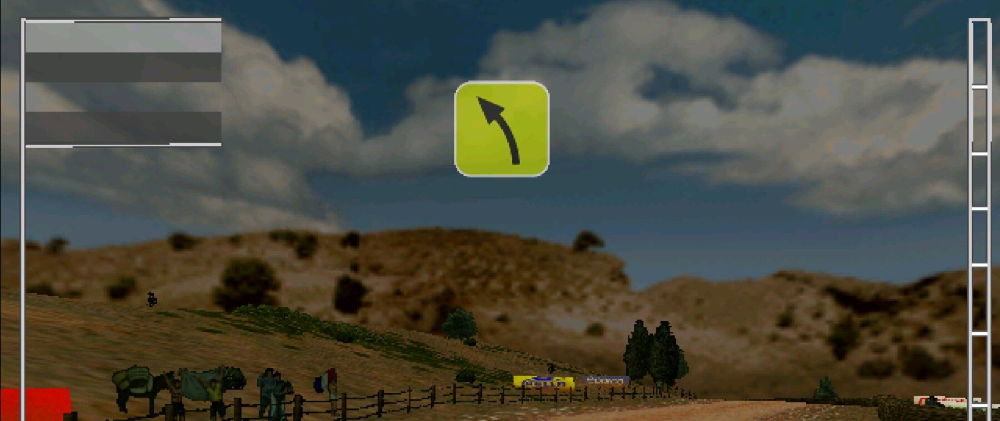
  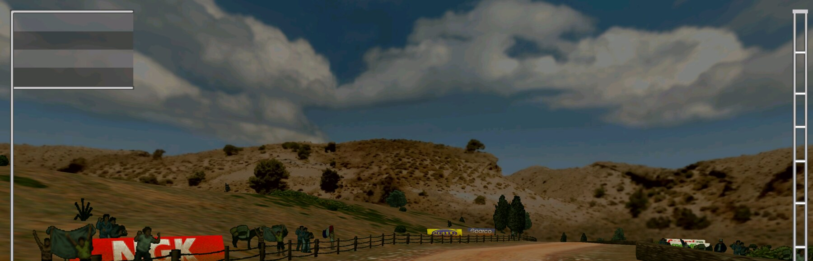
  
Cenários de fundo em HD no Colin McRae Rally, pelo launcher

<!--
Restam: ~38:58 (25s)

- Detalhe do Enhanced: os cenários de fundo (céu, nuvens, montanhas) em HD, em vez das texturas borradas de 1998.
- Capturas de hoje (20/nov), direto do gamescope.
- Ponte: e daí pra frente, o próximo passo foi reconstruir o jogo inteiro.
-->

---

<!-- _class: center tone-extra-dark rg rg-rally -->

  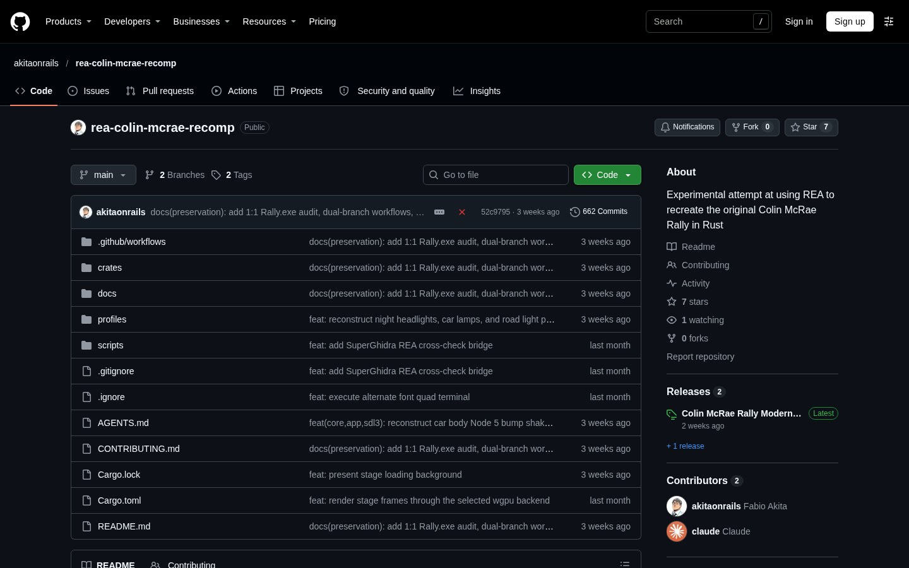

github.com/akitaonrails/rea-colin-mcrae-recomp

<!--
Restam: ~38:33 (25s)

- Aí eu fui mais longe: em vez de remendar o executável, reconstruir o jogo inteiro.
- rea-colin-mcrae-recomp: o Colin McRae Rally de 1998 recriado em Rust, com REA (engenharia reversa por análise estática).
- Sem nenhum asset do jogo no repositório: você aponta pra sua cópia legal.
-->
---

<!-- _class: center tone-extra-dark rg rg-rally -->

rea-colin-mcrae-recomp • v0.1.4, 20/nov/2026

# Colin McRae em Rust

  
<strong>~230 mil</strong>linhas de Rust

  
<strong>3.013</strong>testes

  
<strong>2.018</strong>funções do Rally.exe mapeadas

  
<strong>704</strong>commits

Single-player completo: 56 estágios em 8 países, campeonato, contra o relógio com carro fantasma, replay, chuva e neve. Release pra Linux e Windows. Multiplayer ficou de fora.

<!--
Restam: ~38:08 (40s)

- Mudou de status: de "trabalho em andamento" pra single-player completo, com release v0.1.4 (AppImage pra Linux, ZIP pra Windows), sem nenhum dado do jogo dentro.
- 2.018 funções do Rally.exe no mapa, 0 parciais no single-player. Honestidade: só 54 foram verificadas instrução por instrução; 690 estão reconstruídas e ligadas no jogo. Não dizer "idêntico ao original".
- Fora de escopo: split-screen pra 2 jogadores e LAN via DirectPlay.
- Desde 1/nov: replay com pausa e avanço, fantasma no contra o relógio, chuva, neve, raio, sol e lens flare, lama acumulando no carro, vibração do force feedback, painel analógico clássico.
- Duas branches: main (preservação, Q16.16, 8 bits de paleta) e modern (4K, 16:9/21:9, até 144+ FPS, MSAA, FSR). Contagem: tokei, sem JSON; 352 arquivos Rust, 14 crates.
-->

---

<!-- _class: center tone-extra-dark rg rg-rally -->
<!-- pptx-video: colin-recomp-4k -->

  <video class="deck-video" src="../assets/games/colin-recomp-4k.mp4" poster="../assets/games/colin-recomp-4k.jpg" data-volume="0.25" loop playsinline preload="auto" style="height:560px;border-radius:14px;box-shadow:0 18px 40px rgba(0,0,0,0.35);background:#000;"></video>

A reconstrução em Rust rodando: estágio na Nova Zelândia, 16:9

<!--
Restam: ~37:28 (25s)

- Isso não é o executável original. É o código em Rust reconstruído, rodando nativo.
- Vídeo gravado em 1/nov. Da v0.1.2 pra cá entraram chuva, neve, replay e fantasma.
- Volume 25%.
-->
---

<!-- _class: center tone-extra-dark rg rg-rally -->

Fui com tudo

<h1 style="font-size:1.6em;margin:0 0 14px 0;">Colin 04, Colin 2005, DiRT e DiRT Rally</h1>

  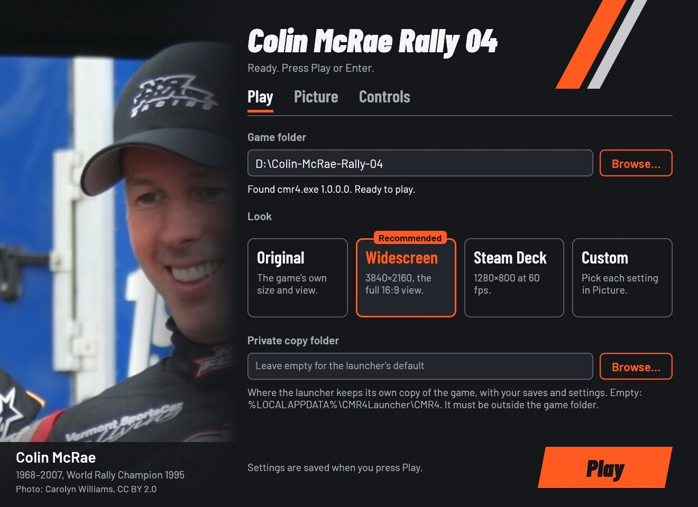
  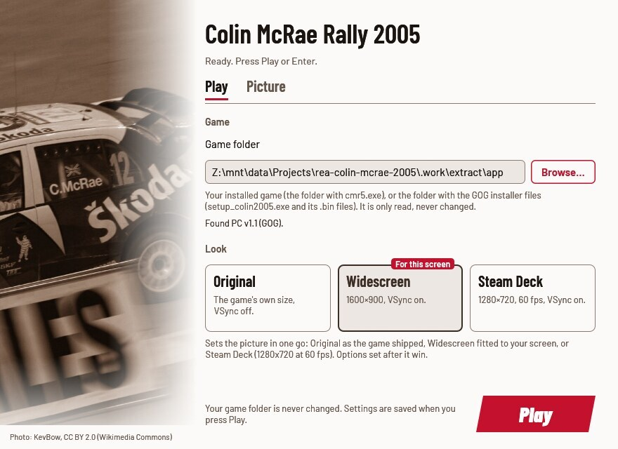
  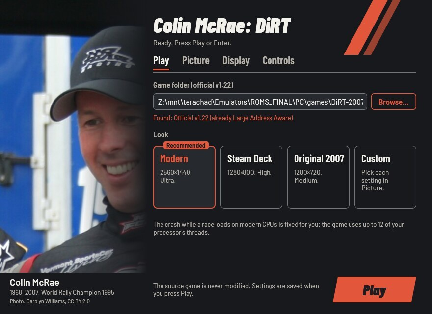
  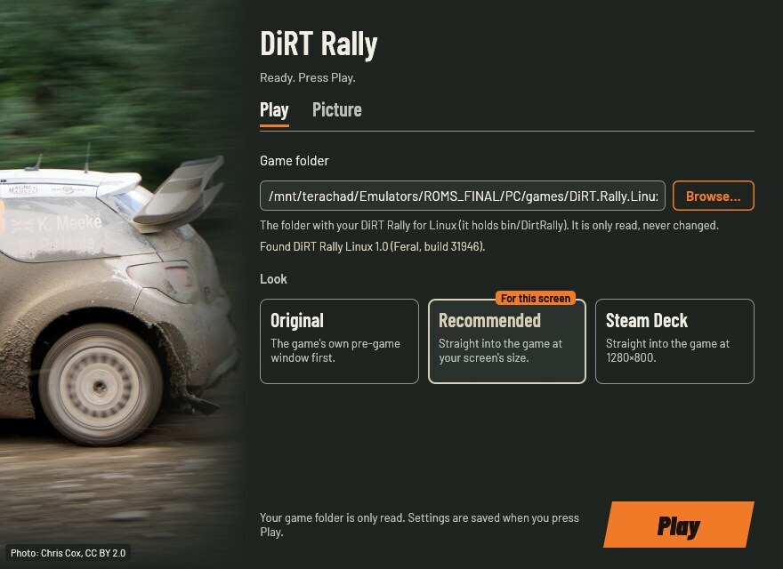

rea-colin-mcrae-4 • rea-colin-mcrae-2005 • rea-dirt • rea-dirt-rally

<!--
Restam: ~37:03 (35s)

- Depois do primeiro, fui com tudo: launcher pro Colin McRae Rally 04, Colin 2005, Colin McRae: DiRT e DiRT Rally.
- Mesmo padrão: escolhe a pasta, escolhe o look (original, widescreen, Steam Deck), joga em 16:9 e alta resolução.
- DiRT: corrigido o crash ao carregar corrida em CPU moderna (jogo agora usa até 12 threads).
- Todos abertos no GitHub, criados entre 1 e 2 de novembro de 2026.
-->
---

<!-- _class: center tone-extra-dark rg rg-rally -->

  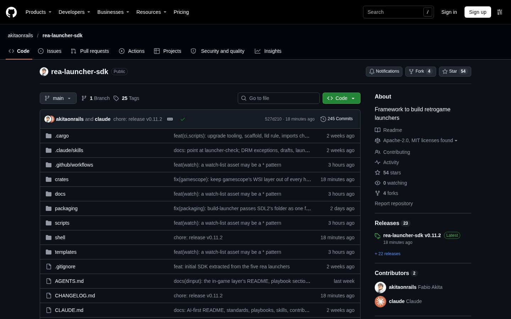

github.com/akitaonrails/rea-launcher-sdk

<!--
Restam: ~36:28 (25s)

- E quando já tinha cinco launchers, extraí o que se repetia: rea-launcher-sdk.
- Framework pra construir launcher de jogo retrô: abas Play/Picture/Controls, looks, cópia privada, gamepad, empacotamento.
- 245 commits, v0.11.2, 23 releases. Os launchers da TeknoParrot (Initial D, Wangan, Sega, Nintendo) e Rad Mobile já saíram dele.
- Post no blog: "Criando um framework para IA com IA: REA Launcher SDK".
-->
---

<!-- _class: center tone-extra-dark rg rg-rally -->

O que os launchers consertaram

<h1 style="font-size:1.6em;margin:0 0 14px 0;">Bug velho, conserto em horas</h1>

  
<strong style="font-size:0.95em;">Colin McRae Rally (1998)</strong>
A corrida parava em 800×600. Agora vai a 4K, em 16:9 de verdade, a 60 fps. E ganhou vibração nos gatilhos que o jogo nunca teve.

  
<strong style="font-size:0.95em;">Colin McRae Rally 04</strong>
O patch de 16:9 da comunidade deixava os carros 25% mais estreitos. A engenharia reversa achou o porquê: renderiza em 4:3 e estica depois.

  
<strong style="font-size:0.95em;">Colin McRae Rally 2005</strong>
"Partículas avançadas" só liberavam num Pentium 4 com Hyper-Threading. Agora em qualquer processador. E no Linux parou de travar antes do menu.

  
<strong style="font-size:0.95em;">Colin 2005 e DiRT Rally</strong>
Os dois saíram direto do SDK: umas 4 a 5 horas cada, da primeira pesquisa até a release. Oito launchers em uns dois dias.

"Nada aqui é técnica nova." O que mudou foi o tempo: semanas por jogo viraram horas.

<!--
Restam: ~36:03 (45s)

- NÃO dizer "ninguém nunca consertou". O próprio post do blog (2/nov) diz: "Nada aqui é técnica nova."
- Crédito: o fix de 16:9 do Colin 04 é do AuToMaNiAk005; o meu achado foi por que ele achatava os carros (função de projeção) e como aplicar certo.
- DiRT: crash em CPU com muitas threads usa o MTFix da comunidade. DiRT Rally: crash em Ryzen 5000+ documentado na issue #3 do Feral.
- Colin 2005: a opção era travada pela detecção de Pentium 4 HT; o launcher usa a chave FORCEHT do próprio jogo. Crash no Linux: faltavam as configurações que o instalador escreve, sem elas o jogo não carrega fontes.
- Colin 1998: o passo de desenho mais lento foi corrigido, 60 fps a 4K no PC de teste. Pack de arte HD redesenhado (HUD, menus, céus, placas).
- A frase do post: "Portar abandonware costumava levar semanas por jogo, e por isso quase ninguém fazia."
-->
---

<!-- _class: center tone-extra-dark rg rg-rally -->

Mais launchers de PC

<h1 style="font-size:1.4em;margin:0 0 18px 0;">Sega Rally Revo e OutRun 2006</h1>

  
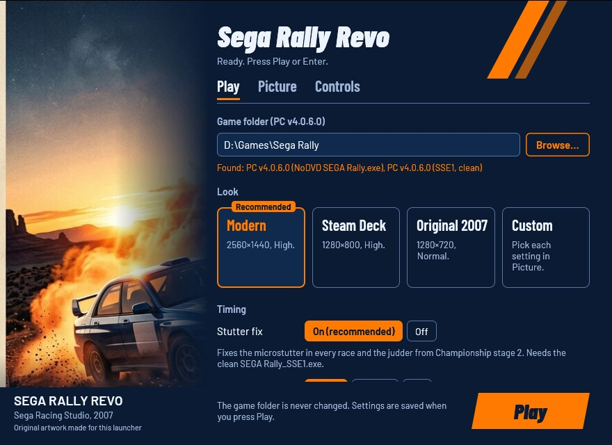
<strong>Sega Rally Revo (2007)</strong>rea-sega-rally-revo

  
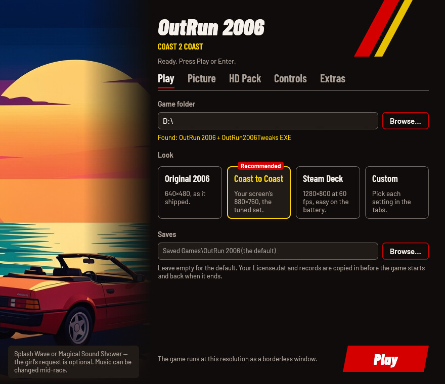
<strong>OutRun 2006 C2C</strong>rea-outrun-2006

<!--
Restam: ~35:18 (25s)

- Sega Rally Revo (2007): visual Modern a 2560×1440 e o stutter fix ligado por padrão (o timer de 1 ms, ver "Achados de verdade").
- OutRun 2006: usa o EXE sem DRM do OutRun2006Tweaks (mod da comunidade, do emoose), instala o mod e baixa o pacote HD. NÃO dizer que o fix é meu.
- Os dois rodam no Windows e no Linux, de uma cópia privada; a pasta do jogo nunca é alterada.
-->

---

<!-- _class: center tone-extra-dark rg rg-arcade -->

Inspiração

  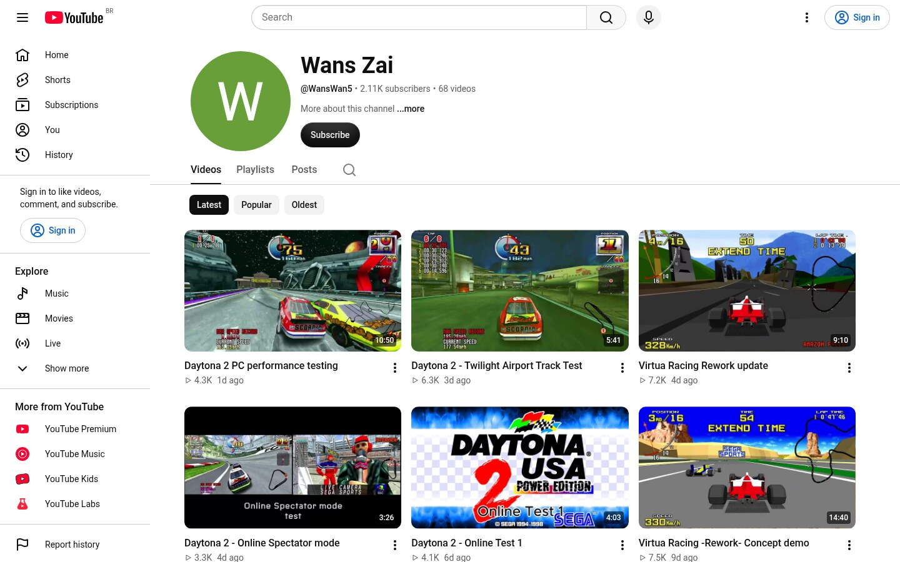

youtube.com/@WansWan5

<!--
Restam: ~34:53 (25s)

- Inspiração: eu sigo e uso os ports de arcade do Wanszai há tempo.
- Canal "Wans Zai": 2,11 mil inscritos, 68 vídeos. Agora está mexendo em Daytona 2 e num rework do Virtua Racing.
-->

---

<!-- _class: center tone-extra-dark rg rg-arcade -->

  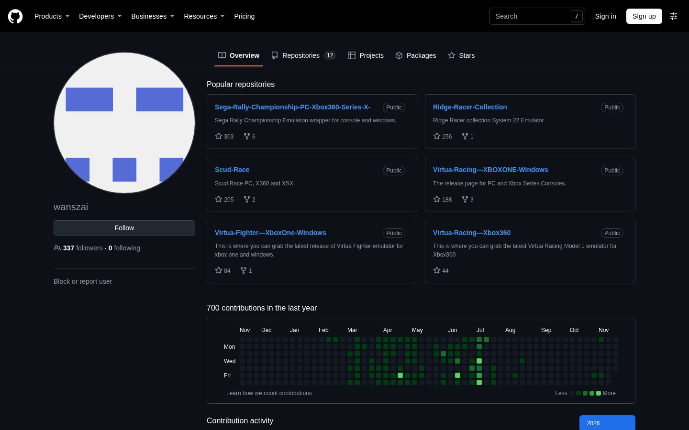

github.com/wanszai

<!--
Restam: ~34:28 (25s)

- Sega Rally Championship (303 estrelas), Ridge Racer Collection, Scud Race, Virtua Racing, Virtua Fighter: arcade da Sega e da Namco rodando em PC e Xbox.
- Ponto: launcher de arcade bem feito, um download, roda e pronto.
- Eu queria um Rad Mobile feito por ele. Não existia. Então fiz o meu, inspirado nos launchers dele, com o que me faltava: suporte de volante de verdade.
-->

---

<!-- _class: center tone-extra-dark rg rg-arcade -->

  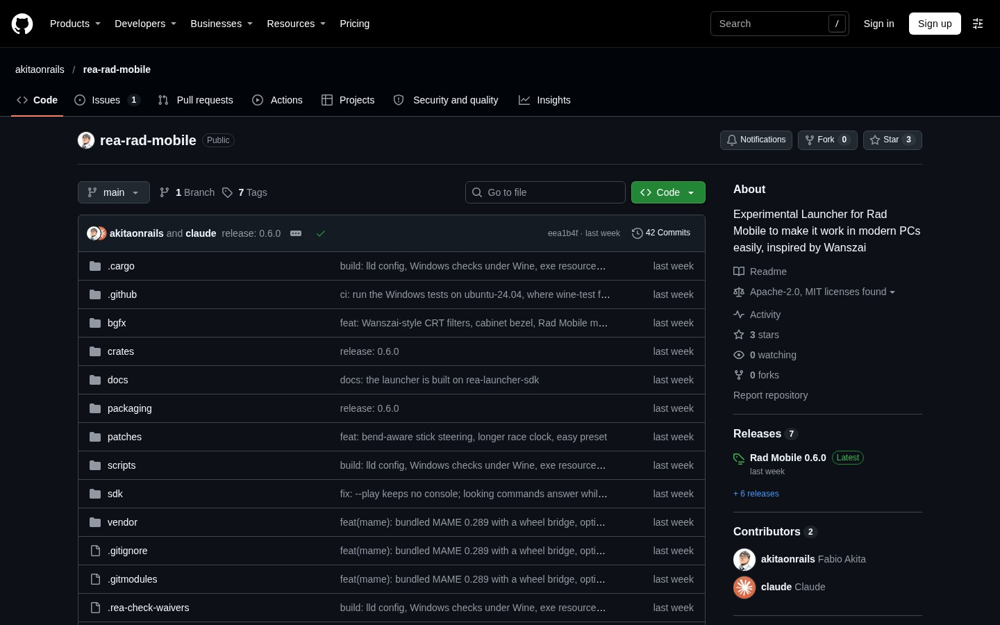

github.com/akitaonrails/rea-rad-mobile

<!--
Restam: ~34:03 (25s)

- Como o Wanszai não tinha Rad Mobile, eu fiz o meu: arcade da Sega de 1990 (System 32), saído do rea-launcher-sdk.
- Launcher experimental pra rodar em PC moderno, Windows e Linux, inspirado nos ports de arcade do Wanszai.
- Leva um MAME 0.289 empacotado e com patch. Sem ROM no repositório: precisa do seu radm.zip.
- 42 commits, v0.6.0.
-->
---

<!-- _class: center tone-extra-dark rg rg-arcade -->

  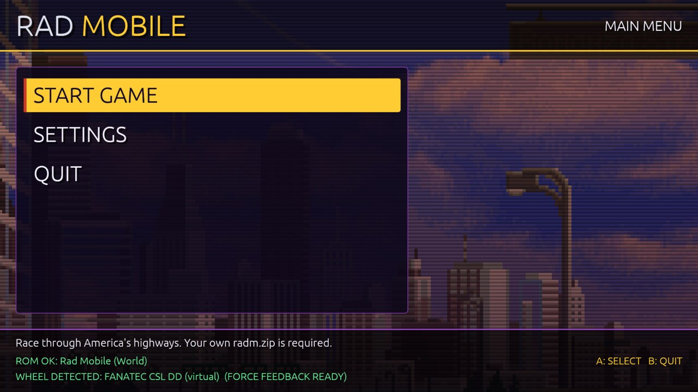

Menu que você dirige com o volante ou o controle

<!--
Restam: ~33:38 (30s)

- O menu é dirigido pelo volante ou pelo controle. Repara embaixo: volante Fanatec detectado, force feedback pronto.
- O arcade tinha volante de 270°, dois pedais e nenhum motor. O launcher lê o volante e escala pra 270°, acha os pedais pela posição de repouso.
- Force feedback que o arcade nunca teve: lê velocidade, posição e batida do jogo rodando e gera as forças.
- Também tem widescreen de verdade (Las Vegas desenhada além da borda 4:3) e filtro de CRT com moldura de gabinete.
-->
---

<!-- _class: center tone-extra-dark rg rg-arcade -->
<!-- pptx-video: rad-mobile -->

  <video class="deck-video" src="../assets/games/rad-mobile.mp4" poster="../assets/games/rad-mobile.jpg" data-volume="0.25" loop playsinline preload="auto" style="height:560px;border-radius:14px;box-shadow:0 18px 40px rgba(0,0,0,0.35);background:#000;"></video>

Rad Mobile (Sega, 1990) pelo launcher, em widescreen

<!--
Restam: ~33:08 (25s)

- Arcade de 1990 rodando em 16:9 de verdade, com volante e force feedback.
- Repara no limpador de para-brisa e no farol: no MAME puro esses botões só funcionavam no teclado.
- Volume 25%.
-->
---

<!-- _class: center tone-extra-dark rg rg-arcade -->

  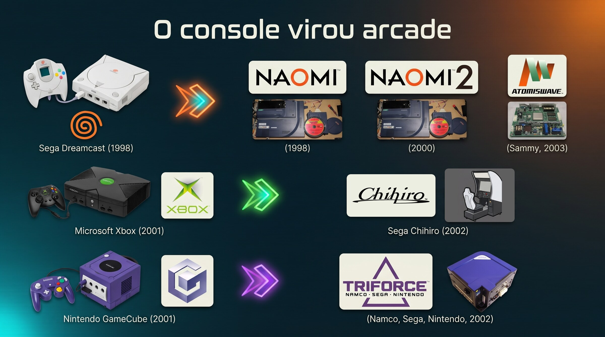

Hardware de console de mesa dentro do gabinete de arcade

<!--
Restam: ~32:43 (35s)

- Pouca gente sabe: a partir do fim dos anos 90 o arcade parou de ter hardware exótico e passou a usar hardware de console.
- Dreamcast virou NAOMI (1998), depois NAOMI 2 com uma segunda GPU, e a Sammy fez o Atomiswave em cima da mesma base.
- Xbox virou Chihiro na Sega (OutRun 2, House of the Dead III). GameCube virou Triforce, parceria Namco, Sega e Nintendo (F-Zero AX, Mario Kart Arcade GP).
- Consequência boa pra gente: quem emula o console chega perto de emular o arcade. O Flycast roda NAOMI e Atomiswave.
-->

---

<!-- _class: center tone-extra-dark rg rg-arcade -->

  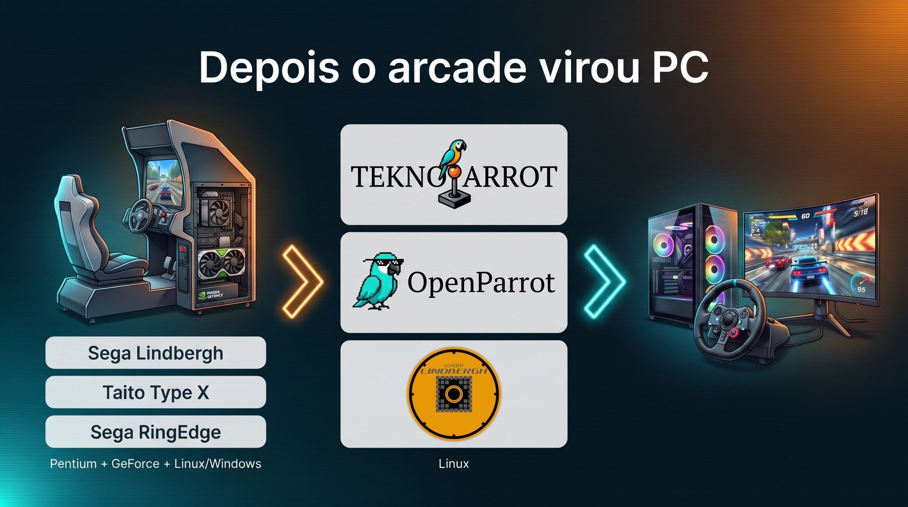

TeknoParrot, OpenParrot e Lindbergh Loader

<!--
Restam: ~32:08 (35s)

- Depois deu mais um passo: o arcade virou PC mesmo. Taito Type X (2004) e Sega RingEdge rodam Windows embarcado; o Sega Lindbergh (2005) é Pentium 4 com GeForce rodando Linux.
- O jogo é um executável. O que falta é a placa de I/O, o dongle e a rede do gabinete.
- TeknoParrot emula essas peças no Windows. O OpenParrot é a parte de código aberto. O Lindbergh Loader roda os jogos do Lindbergh direto no Linux.
- Só que o TeknoParrot é Windows/.NET e recusa o Wine. Meus launchers rea-teknoparrot (Sega, Initial D, Wangan) trocam ele por loaders abertos, como o lindbergh-loader, e rodam direto no Linux.
-->

---

<!-- _class: center tone-extra-dark rg rg-street -->

  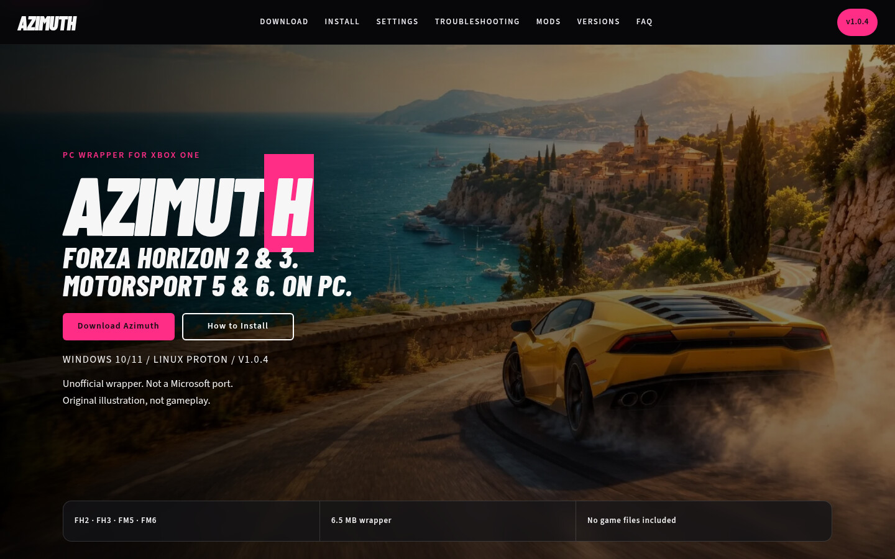

azimuthforza.com

<!--
Restam: ~31:33 (30s)

- Mesma história, uma geração depois: o Xbox One é x86, praticamente um PC.
- Azimuth, da Almost There Games: roda as versões de Xbox One de Forza Horizon 2 e 3 e Forza Motorsport 5 e 6 no Windows e no Linux via Proton.
- Não é emulador: o código do jogo roda nativo, o wrapper traduz as chamadas de sistema e de gráfico.
- Versão 1.0 saiu em 26/out/2026. O azimuthforza.com é um guia independente; o download oficial é no itch.io.
-->

---

<!-- _class: center tone-extra-dark rg rg-street -->

  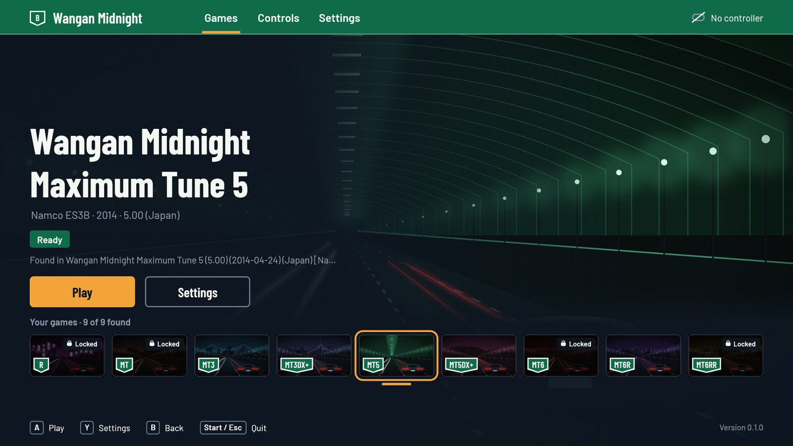

rea-teknoparrot-wangan-series

<!--
Restam: ~31:03 (30s)

- Wangan Midnight R e Maximum Tune 3, 3DX+, 5, 5DX+, 6, 6R e 6RR num launcher só.
- Sem TeknoParrot: OpenParrot e OpenParrot_WMMT compilados do código-fonte, com correções minhas. MT3 e 3DX+ rodam nativos no Linux, até 4K.
- No 5 ao 6RR a UI do TeknoParrot era a placa de I/O do gabinete. Fiz a minha, wangan-io, falando o protocolo JVS da Namco.
- Ressalva honesta: volante e force feedback ainda não testados em hardware.
-->

---

<!-- _class: center tone-extra-dark rg rg-street -->
<!-- pptx-video: wangan-6r -->

  <video class="deck-video" src="../assets/games/wangan-6r.mp4" poster="../assets/games/wangan-6r.jpg" data-volume="0.25" loop playsinline preload="auto" style="height:560px;border-radius:14px;box-shadow:0 18px 40px rgba(0,0,0,0.35);background:#000;"></video>

Wangan Midnight Maximum Tune 6R pelo launcher

<!--
Restam: ~30:33 (25s)

- Maximum Tune 6R rodando no Linux, terminando com o YOU WIN.
- Volume 25%.
-->

---

<!-- _class: center tone-extra-dark rg rg-street -->

  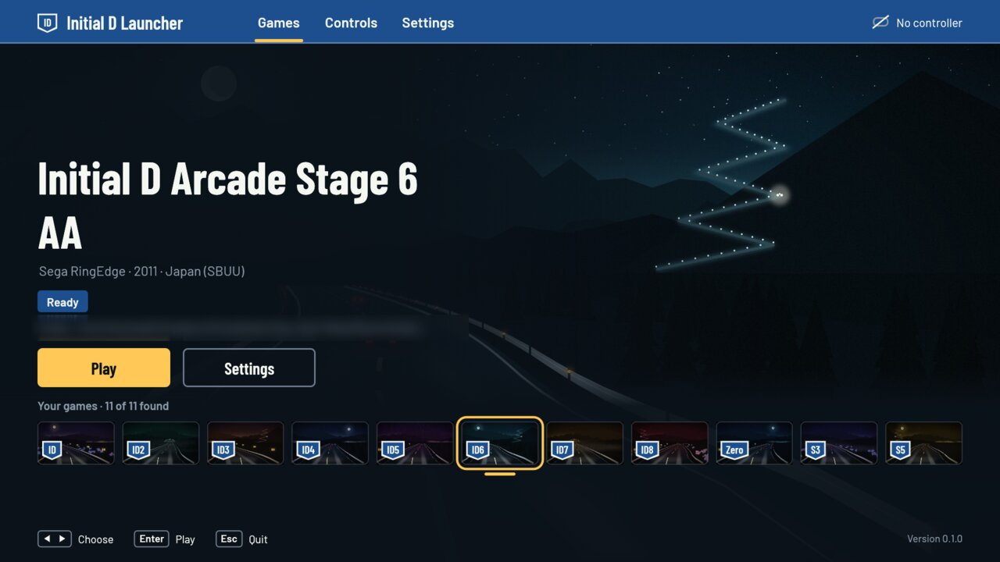

rea-teknoparrot-initial-d-series

<!--
Restam: ~30:08 (30s)

- Do Arcade Stage Ver. 1 (2002, NAOMI 2) ao THE ARCADE Season 5 (2025), Linux e Windows.
- Só loader aberto: Flycast pro NAOMI 2, lindbergh-loader nativo pro 4 e 5, windowsarcadeloader do 6 ao THE ARCADE.
- O core do TeknoParrot pros mais novos é fechado, e resolução, CRT e force feedback ficam no Patreon.
- Corrigi o leitor de cartão do 4, o Start travado do Zero e o som que crashava no Wine.
-->

---

<!-- _class: center tone-extra-dark rg rg-street -->
<!-- pptx-video: initial-d-ta5 -->

  <video class="deck-video" src="../assets/games/initial-d-ta5.mp4" poster="../assets/games/initial-d-ta5.jpg" data-volume="0.25" loop playsinline preload="auto" style="height:560px;border-radius:14px;box-shadow:0 18px 40px rgba(0,0,0,0.35);background:#000;"></video>

Initial D THE ARCADE Season 5 pelo launcher

<!--
Restam: ~29:38 (25s)

- THE ARCADE Season 5, de 2025, rodando via windowsarcadeloader.
- Repara na cena em estilo mangá no meio da corrida.
- Volume 25%.
-->

---

<!-- _class: center tone-extra-dark rg rg-street -->

Mais launchers de arcade

<h1 style="font-size:1.4em;margin:0 0 22px 0;">Sega e Nintendo</h1>

  
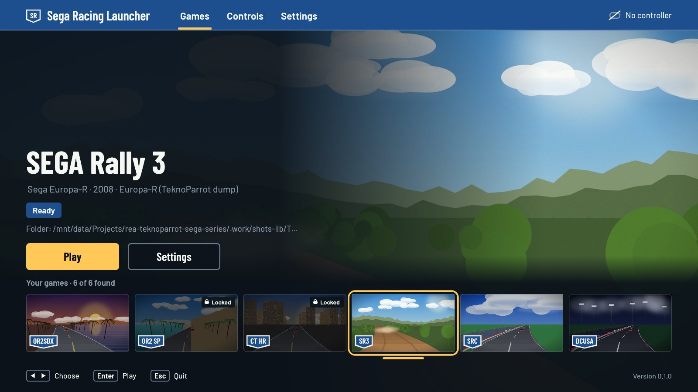
<strong>Arcades Sega</strong>rea-teknoparrot-sega

  
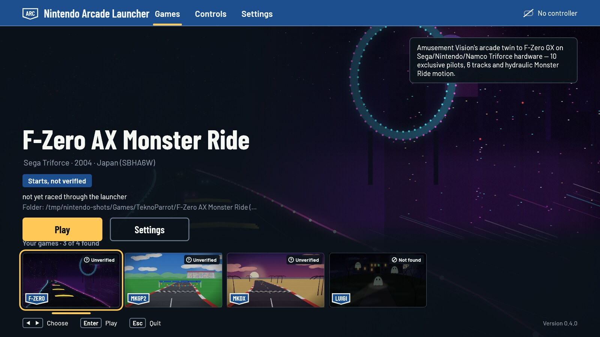
<strong>Arcades Nintendo</strong>rea-teknoparrot-nintendo

<!--
Restam: ~29:13 (25s)

- Sega: um launcher acha os 6 jogos (OutRun 2 SP e SDX, Chase HQ 2, Sega Rally 3, Sega Racing Classic, Daytona USA) e escolhe o loader de cada um.
- Nintendo (v0.4.0, 21/nov): F-Zero AX e Mario Kart GP 2 no Dolphin oficial, agora com widescreen 16:9 no Triforce; Mario Kart DX e Luigi's Mansion pelo windowsarcadeloader.
- Mesma cara do Wangan e do Initial D: card por jogo, Play, controles e ajustes.
-->

---

<!-- _class: center tone-extra-dark rg rg-dossier -->

Por cima do jogo original

<h1 style="font-size:1.5em;margin:0 0 16px 0;">Melhor que no lançamento</h1>

  <h3>Imagem</h3>
  

Colin McRae Rally

800×600, só 4:34K, 16:9 de verdade

  

Colin McRae Rally 3

640×480 esticadoqualquer tela, menus HD

  

Colin McRae 04

16:9 espremia carros16:9 sem distorcer

  

Colin McRae 2005

640×480 no canto16:9 na tela toda

  

Screamer (DOS)

4:3 esticado16:9 vendo mais dos lados

  

Rad Mobile

4:3 do gabinetewidescreen real, filtro CRT

  

Arcades Sega

800×480resolução maior com FSR

  <h3>Controle e volante</h3>
  

Colin McRae Rally

só o analógicogatilhos e vibração

  

Colin 3 e 04

gatilhos num eixo sófrear com o pé esquerdo

  

Colin McRae 2005

volante e pedais à parteum volante só

  

Screamer (DOS)

controle nem apareceanalógico e vibração

  

DiRT Rally

joystick estranhopad reconhecido

  

Rad Mobile

sem volantevolante com force feedback

  

F-Zero AX

volante parava em 79%curso completo

Em vários, a base é da comunidade: SilentPatch, Xidi, HD UI do Bekoha.

<!--
Restam: ~28:48 (45s)

- Colin 1998: o jogo não oferecia corrida acima de 800×600. Agora vai a 4K, 16:9 mostra mais dos lados, e HUD, menus e céus vêm redesenhados no pacote de arte HD. 60 fps a 4K.
- Colin 3: widescreen e interface são do SilentPatch, a HD UI é do Bekoha; o launcher empacota e configura. NÃO dizer que fiz isso.
- Colin 04: o patch de 16:9 da comunidade deixava carro 25% mais estreito; o launcher renderiza 4:3 a 2880×2160 e o dgVoodoo estica.
- Controles: Xidi (terceiro) transforma o controle num gamepad clássico no Colin 3 e 04. Colin 2005 ganhou o "rea wheel": volante + pedais vistos como um só.
- Rad Mobile: filtros CRT inspirados no Wanszai. F-Zero AX: o analógico emulado do Dolphin parava em 79% do curso.
-->

---

<!-- _class: center tone-extra-dark rg rg-dossier -->

Launchers de PC: o que a engenharia reversa achou

<h1 style="font-size:1.6em;margin:0 0 14px 0;">Achados de verdade</h1>

  
<strong style="font-size:0.95em;">Screamer (1995, DOS)</strong>
Widescreen 16:9 num jogo de DOS, mexendo na matriz da câmera. E o motivo de destravar FPS quebrar o jogo: a física roda presa a 50 Hz.

  
<strong style="font-size:0.95em;">Screamer 2 e Rally em 3dfx</strong>
A cópia da GOG traz um driver Glide de Windows que não funciona no DOS. Com o driver do Screamer Rally e o fix do MAXCACHE, o modo 3dfx volta.

  
<strong style="font-size:0.95em;">DiRT Rally no Linux</strong>
Crashava em todo Ryzen 5000 pra cima: o jogo lê memória que marcou só pra executar, e CPU nova bloqueia. Uma biblioteca minúscula resolve.

  
<strong style="font-size:0.95em;">Sega Rally Revo</strong>
Engasgava uma vez por segundo no Windows: desde o Windows 10 2004 o timer de 1 ms é por processo, e o jogo nunca pedia o dele.

Cada achado virou um rascunho pro PCGamingWiki.

<!--
Restam: ~28:03 (45s)

- Os achados do Screamer são todos nossos, saídos da engenharia reversa (docs/CONTRIBUTIONS.md, S1 a S9). Ressalva: o widescreen do Screamer 2/Rally e a distância de desenho ainda pedem verificação visual.
- 50 Hz: o loop é fixo (2 ticks de um timer de 100 Hz) e a física vem de uma tabela de 50 entradas. O PCGamingWiki diz 60 FPS; isso corrige o wiki.
- DiRT Rally: execute-only memory + CPUs com PKU (Zen 3 em diante). Já existia um shim da comunidade (bolokanar, sem licença); o nosso é próprio, MIT/Apache. NÃO dizer que ninguém tinha resolvido.
- Sega Rally Revo: o fix do stutter é do stuken (reescrita clean-room). O achado nosso é o do timer por processo.
- Os rascunhos ainda não foram postados; eu reviso e posto.
-->

---

<!-- _class: center tone-extra-dark rg rg-dossier -->

Launchers rea-teknoparrot

<h1 style="font-size:1.6em;margin:0 0 14px 0;">Arcade no Linux, sem TeknoParrot</h1>

  
<strong style="font-size:0.95em;">Initial D Arcade Stage 4</strong>
Crashava em toda largada. Um watchpoint de hardware achou o culpado: o leitor de cartão emulado escrevia fora do objeto e apagava os controles. Conserto: 1 byte.

  
<strong style="font-size:0.95em;">Wangan Maximum Tune 5 ao 6RR</strong>
No TeknoParrot a interface fazia o papel da placa de I/O do gabinete. Escrevi a minha, falando o protocolo JVS da Namco. E corrigi o crash do MT6 no Wine.

  
<strong style="font-size:0.95em;">F-Zero AX e Mario Kart GP</strong>
Triforce no Dolphin oficial, não num build privado. O analógico emulado parava em 79% do curso; abri a trava e o volante chega no fim.

  
<strong style="font-size:0.95em;">Sega: OutRun 2, Daytona, Sega Rally 3</strong>
O câmbio H de 4 marchas do gabinete vira borboletas, o volante gira 270° como no arcade, e o Daytona ganhou um perfil escrito pra ele.

Só loader aberto, compilado do código-fonte, com os nossos patches.

<!--
Restam: ~27:18 (45s)

- TeknoParrot: UI em .NET, crasha no WoW64 do Wine 11, core fechado pro Initial D 6 ao THE ARCADE, e opções no Patreon.
- Initial D 4: o lindbergh-loader troca cRealCardIF por cFileCardIF, mas o objeto fica alocado com 0x34 bytes e o novo usa até 0x40. O flag de "loading" cai no objeto vizinho (cUiJVS) e zera o vptr. Patch: tamanho da alocação pra 0x80. Não há issue sobre isso no lindbergh-loader.
- Também no Initial D: Zero preso na calibração do volante (o loader segurava o Start), som crashando no Wine (XAudio2 nativo).
- Wangan: wangan-io portado do código GPL do TeknoParrotUI. Volante e force feedback ainda não testados em hardware.
- Nintendo: o código "Bypass Cycraft" do Monster Ride é da comunidade.
-->

---

<!-- _class: center tone-extra-dark rg rg-dossier -->

github.com/akitaonrails

# 14 launchers rea-*

<table class="bench launchers">
<tr><th>rea-*</th><th>Jogos</th></tr>
<tr><td class="md"><strong>colin-mcrae</strong></td><td>Colin McRae Rally (1998)</td></tr>
<tr><td class="md"><strong>colin-mcrae-3</strong></td><td>Colin McRae Rally 3</td></tr>
<tr><td class="md"><strong>colin-mcrae-4</strong></td><td>Colin McRae Rally 04</td></tr>
<tr><td class="md"><strong>colin-mcrae-2005</strong></td><td>Colin McRae Rally 2005</td></tr>
<tr><td class="md"><strong>dirt</strong></td><td>Colin McRae: DiRT (2007)</td></tr>
<tr><td class="md"><strong>dirt-rally</strong></td><td>DiRT Rally (2015), Linux</td></tr>
<tr><td class="md"><strong>screamer-trilogy</strong></td><td>Screamer 1, 2 e Rally</td></tr>
</table>
<table class="bench launchers">
<tr><th>rea-*</th><th>Jogos</th></tr>
<tr><td class="md"><strong>outrun-2006</strong></td><td>OutRun 2006 C2C</td></tr>
<tr><td class="md"><strong>sega-rally-revo</strong></td><td>Sega Rally Revo (2007)</td></tr>
<tr><td class="md"><strong>rad-mobile</strong></td><td>Rad Mobile (1990)</td></tr>
<tr><td class="md"><strong>teknoparrot-sega</strong></td><td>OutRun 2 SP, Sega Rally 3, Daytona...</td></tr>
<tr><td class="md"><strong>teknoparrot-initial-d</strong></td><td>Initial D: Stage 1 ao THE ARCADE</td></tr>
<tr><td class="md"><strong>teknoparrot-wangan</strong></td><td>Wangan Midnight: R ao MT 6RR</td></tr>
<tr><td class="md"><strong>teknoparrot-nintendo</strong></td><td>F-Zero AX, Mario Kart GP, Luigi</td></tr>
</table>

<!--
Restam: ~26:33 (40s)

- Na tabela os teknoparrot-* são os repos rea-teknoparrot-*-series. Coluna da esquerda: PC antigo (Colin, DiRT, Screamer em DOSBox). Direita: Sega e arcades (Lindbergh, RingEdge, Namco ES3, Triforce, NAOMI 2).
- Todos seguem a mesma regra: seu jogo, sua cópia, pasta original só leitura, launcher roda de uma cópia privada.
- Windows, Steam Deck e Linux. Fora disso tem o rea-launcher-sdk e o recomp do Colin em Rust, que não são launchers.
-->

---

<!-- _class: center tone-extra-dark -->

  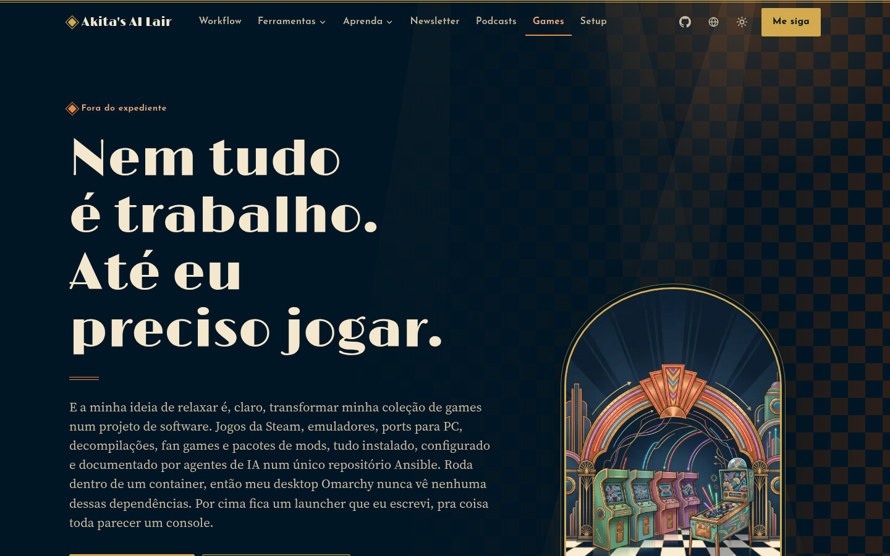

ailair.akitaonrails.com/pt-br/games

<!--
Restam: ~25:53 (25s)

- Tudo o que mostrei hoje está documentado aqui: distrobox-gaming, omarchy-games-menu, os launchers de corrida e o Fun to Drive.
- Um repositório Ansible, rodando num container, com um launcher por cima pra parecer console.
- Você precisa da sua própria cópia de cada jogo. Nenhum launcher traz arquivo de jogo.
-->

---

<!-- _class: center end tone-extra-dark -->

Fonte: https://commons.wikimedia.org/wiki/File:Standing_Ovation_(21835796).jpg

  <h1 style="font-size:3.9em;line-height:0.9;margin:90px 0 70px 0;letter-spacing:0.02em;">OBRIGADO</h1>
  

    

      codeminer42.com
      themakitachronicles.com
      github.com/akitaonrails/tropicalruby-2026
    

  

<!--
Restam: ~25:28 (10s)

- Obrigado.
- Os links estão aí embaixo.
-->

---

<!-- _class: ai ai-wine finale -->

  

    
Merchan sem vergonha

    <h1 style="font-size:2.3em;line-height:0.95;margin:0 0 22px 0;">Assine The M.Akita Chronicles</h1>
    
Se você curtiu essa palestra, vai lá assinar. Toda semana tem bastidor real, código real e projeto real em produção.

    

      
      

        
Aponta a câmera ou digita:

        
themakitachronicles.com

      

    

  

  

    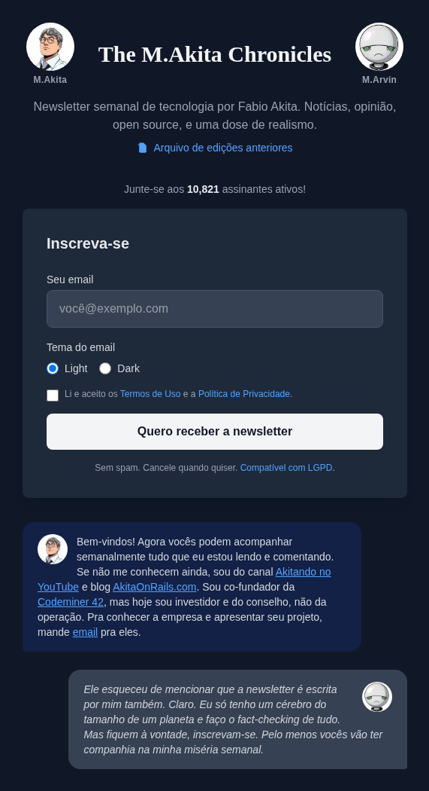
  

<!--
Restam: ~25:18 (25s)

- E antes de você ir embora, sem falsa modéstia: se curtiu a palestra, assina o The M.Akita Chronicles.
- Está tudo aí na tela, com QR code pra quem quiser apontar a câmera.
- É onde eu continuo publicando bastidor real, projeto real, código real e o que deu certo ou errado em produção.
- Quer acompanhar essa linha de raciocínio semana a semana? Vai em themakitachronicles.com e assina.
-->